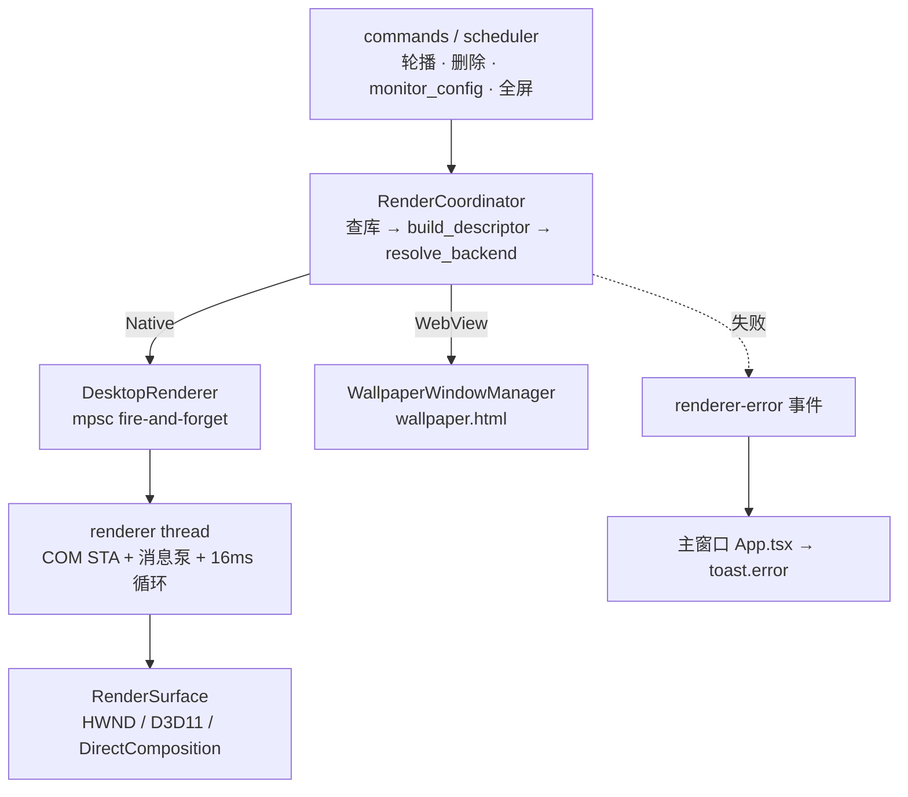

# Native Wallpaper Renderer 技术文档

> **模块路径**: `src-tauri/src/platform/wallpaper_renderer/`（跨平台契约）+ `src-tauri/src/platform/windows/desktop_renderer/`（Windows 实现）+ `src-tauri/src/ctx/render_coordinator.rs`（协调器）
> **最后更新**: 2026-11-20（M5 跨屏拼接落地、图片 extend / mirror 已 Windows 实机验证；解码缓存与 dev 构建优化 `d639b63`，见 3.12；M6 MediaFoundation 流式视频解码，见 3.13；M7 Native↔Native 换图 crossfade，见 3.14；M8 WebView capability fallback 接线，见 3.15；控制链路收尾与副屏跟随修复，见 3.16）
> **适用系统**: Windows 11 24H2 / 25H2 实机验证通过；macOS / Linux 编译通过但为空实现
> **关联文档**: `DESKTOP_EMBEDDER_TECH_DOC.md`（WorkerW 嵌入层，本文档不重复其版本兼容与 NC 补偿细节）
> **分支**: `feature/native-wallpaper-renderer`

---

## 一、模块概述

`desktop_renderer` 是 mini-wallpaper 的**原生壁纸渲染层**，用一条 D3D11 + DirectComposition 渲染线程替代「每个显示器一个 WebView2 壁纸窗口」的方案，把图片 / GIF / 动态 WebP 直接画进 WorkerW 桌面层级。

### 1.1 为什么要做

原方案为每块显示器创建一个 `.decorations(false).transparent(true)` 的 Tauri 窗口加载 `wallpaper.html`。内存大头不在 WorkerW 嵌入本身，而在**每屏一份 Edge/Chromium renderer 进程**：壁纸只是展示一张图片，却要为它常驻一套完整浏览器渲染管线。

```
改造前：每屏 1 个 WebView2 窗口 = 每屏 1 套 Chromium renderer
改造后：全应用 1 个 D3D11 device + 1 条渲染线程 + 每屏 1 个 IDCompositionVisual
```

WorkerW / Progman / SHELLDLL_DefView 的桌面嵌入层**继续复用** `desktop_embedder`，原生渲染只替换「窗口里画什么」这一层。

### 1.2 桌面层级中的落点

```
┌──────────────────────────────────────────────────────────┐
│  Progman (24H2+)                                          │
│    ├── WorkerW (子窗口 #0) ← SHELLDLL_DefView（桌面图标）   │
│    └── WorkerW (子窗口 #1) ← 壁纸嵌入目标                  │
│          └── NativeWindow (WS_CHILD, WS_EX_NOREDIRECTIONBITMAP)
│                └── IDCompositionTarget
│                      └── IDCompositionVisual
│                            └── IDXGISwapChain1 (ForComposition)
│                                  └── D3D11 RenderTargetView
│                                        └── 纹理 QUAD
└──────────────────────────────────────────────────────────┘
```

> `SHELLDLL_DefView` 在 Progman 子窗口 #0、目标 WorkerW 在 #1 属于 24H2 的正常壁纸层级，不是嵌入错位。

### 1.3 产品边界（已确认的设计决策）

| 决策 | 结论 | 理由 |
|------|------|------|
| 系统壁纸 API | ❌ 不采用 | 无法承载 GIF / 视频 / 轮播 / 逐屏配置 |
| `.webp` / `.webm` | 媒体格式，**不是 HTML 网页壁纸** | 扩展名相同不代表渲染模型相同 |
| HTML / JS / WebGL 网页壁纸 | 暂不支持 | 需要浏览器运行时，与降内存目标冲突 |
| 图片 / 视频 | 一律走 WorkerW + 原生渲染器 | 保持逐屏一致的输入路径 |
| FFmpeg | ❌ 不引入 | 体积 / 许可 / 构建链成本过高 |
| 不支持的格式 | 直接报错，不静默降级 | 避免「以为显示成功其实没画面」 |
| WebView / Native 并存 | ✅ 接受 | 本地验证期间必须 **NativeOnly、零 WebView** |
| WebView fallback 语义 | **解码前 capability fallback** | 选中 Native 后解码失败只报错，不能当 error fallback |
| fallback 页面 | 复用现有 `wallpaper.html` + `src/pages/wallpaper/` | 不新建极简 fallback 页，避免第二套前端 |
| fallback 窗口生命周期 | 非持续存在 | 切回 Native 可支持格式时销毁 |
| 渲染 API | D3D11 | 与 DirectComposition / DXGI flip model 配套最成熟 |

---

## 二、架构分层：控制面 / 渲染面分离

### 2.1 职责边界

| 层 | 位置 | 负责 | 不负责 |
|----|------|------|--------|
| **控制面** | `runtime/scheduler`、`services`、`commands`、`RenderCoordinator` | 决定「显示什么」：查库、选壁纸、轮播、fitMode、全屏暂停、backend 决策 | 不碰 HWND / D3D11 / COM |
| **渲染面** | `platform/wallpaper_renderer`、`platform/windows/desktop_renderer` | 决定「怎么画」：解码、纹理上传、swapchain、Present、窗口几何 | **不查 DB、不认识实体、不做业务判断** |



**为什么协调器不塞进 `WallpaperWindowManager`**：WM 只管 WebView 窗口创建与事件 emit，不持有 db / renderer，无法判断壁纸能否被原生解码；把 backend 决策塞进去会让它同时依赖 db 与 renderer，且通知方法是同步 emit，承载不了「查库 → 决策 → 路由」的异步链。独立协调器让调用方只锁一个对象，避免双锁持锁。

### 2.2 渲染契约（`contracts.rs`）

```rust
#[derive(Clone, Debug, PartialEq, Eq, Serialize, Deserialize)]
#[serde(rename_all = "camelCase")]
pub struct RenderDescriptor {
    pub monitor_id: String,
    pub wallpaper_id: Option<i32>,
    pub file_path: PathBuf,
    pub kind: WallpaperKind,
    pub fit_mode: FitMode,
    pub display_mode: DisplayMode,
    pub backend: RenderBackend,
    pub extend_viewport: Option<ExtendViewport>,
}
```

契约表达的原则是：**渲染层接收一份完整描述，不再反问业务层**。当前 `RenderCoordinator` 内部实际使用的是精简版 `Descriptor { file_path, kind, backend, fit_mode }`，`RenderDescriptor` / `ExtendViewport` / `DisplayMode` 属于 M5 mirror / extend 的**契约先行**部分（详见 5.3）。

错误码统一为 `RendererErrorCode`（`UnsupportedFormat` / `BackendUnavailable` / `DecodeFailed` / `DeviceLost` / `EmbedFailed` / `BackendSwitchFailed`），经 `RendererErrorPayload` 发到前端。

### 2.3 backend 决策（`selection.rs`）

| 模式 | 生效条件 | 行为 |
|------|----------|------|
| `NativeOnly` | `cfg!(debug_assertions)` 恒真；或 release 下 `MINI_WALLPAPER_RENDERER=native` | 绝不创建 WebView；不支持格式直接报错 |
| `Auto` | release 默认 | 按 capability 自动分流：Native 支持表内的格式走 Native，表外的全部走 WebView fallback |

```rust
pub fn resolve_backend(
    kind: WallpaperKind,
    file_path: &Path,
    selection: BackendSelection,
) -> Result<RenderBackend, RendererError>
```

| 壁纸 | NativeOnly | Auto |
|------|-----------|------|
| 图片 / GIF / WebP（静态与动态） | `Native` | `Native` |
| `.mp4` / `.m4v` / `.mov` / `.avi` / `.wmv` / `.asf` / `.3gp` / `.3g2` / `.3gp2` / `.3gpp` | `Native`（MF 解码） | `Native`（MF 解码） |
| `.webm` / `.mkv` | `UnsupportedFormat` 报错 | `WebView`（解码前 capability fallback） |
| 其它视频扩展名 | `UnsupportedFormat` 报错 | `WebView`（同上） |

上面 10 个扩展名来自微软官方 *Supported Media Formats in Media Foundation* 的 File Containers 表（3GP / ASF / AVI / MPEG-4）。声明的是「交给 Media Foundation 的 SourceReader 尝试」，不保证容器内编码一定能解：`.mp4` 里装 HEVC 但系统没装对应 codec 时，SourceReader 打开失败会通过命令 ack 回传 `DecodeFailed`，不静默黑屏、不回退 WebView。

> **WebView 只做解码前的 capability fallback，不是解码失败后的兜底。** 一旦 `resolve_backend` 返回 Native，SourceReader / `decode_frames` 失败都通过 mpsc + oneshot ack 回传协调器，发 `renderer-error`，不会偷偷重建 WebView 窗口。M8 把 Auto 模式的 fallback 接回后这条铁律不变：分流依据是「容器在不在 MF 支持表」，不是「这次解码成不成功」。本地 dev 默认 NativeOnly，仍不出现 WebView2。

### 2.4 错误上报链路

```
renderer thread 内失败（surface 创建 / 图片解码 / SourceReader 打开）
  → oneshot ack 回传 DesktopRenderer::{ensure_monitor, set_wallpaper}
  → RenderCoordinator 拿 Err → report_error(...)
  → TypedEmit(RendererErrorPayload { monitor_id, wallpaper_id, code, message })
  → EVENTS.RENDERER_ERROR ("renderer-error")
  → App.tsx useEffect listen → toast.error(`${message} (${monitor_id})`)
```

`DesktopRenderer` 的命令仍是 mpsc 派发（保序、fire-and-forget），但关键的两条带 `tokio::sync::oneshot` 回执：`ensure_monitor` 与 `set_wallpaper`。M6 之前它们只 `log::error!`，用户看不到任何提示；现在函数变成 `async`，失败用 `DecodeFailed` / `BackendUnavailable` 编码回到协调器。其余命令（几何 / fitMode / clear / pause / destroy）仍不回执。

前端 `EventMap` 同步补齐了 `RendererErrorPayload`，保持既有事件类型安全。

---

## 三、最终方案：D3D11 + DirectComposition

### 3.1 窗口创建：创建期样式是关键

```rust
// window.rs
CreateWindowExW(
    WS_EX_NOREDIRECTIONBITMAP | WS_EX_NOACTIVATE | WS_EX_TOOLWINDOW,
    CLASS_NAME, WINDOW_NAME, WS_POPUP,
    rect.x, rect.y, rect.width, rect.height, ...
)?;
```

`WS_EX_NOREDIRECTIONBITMAP` 是**创建期样式**，不能等 `SetParent` 之后再补。它告诉 DWM 不要为这个 HWND 建立传统 GDI 重定向位图——DirectComposition target 依赖这一点。窗口类 `MiniWallpaperNativeRenderer` 用 `OnceLock` 保证只注册一次，`Drop` 里 `DestroyWindow`。

### 3.2 嵌入与 swapchain 的时序

`RenderSurface::new` 的顺序不可调换：

```
1. NativeWindow::new          （创建窗口，带 WS_EX_NOREDIRECTIONBITMAP）
2. embed_in_desktop(..., EmbedPolicy::Native)   ← 先拿到最终父子关系
3. window.show() + normalize_native_ex_style()
4. D3D11CreateDevice          （BGRA_SUPPORT）
5. create_pipeline            （shader / input layout / VB / sampler / rasterizer）
6. create_composition_swap_chain(device, hwnd, w, h)
7. bind_current_backbuffer()
```

早期版本在 `SetParent` 之前就创建 HWND swapchain，DXGI 拿到的 HWND 还是顶层窗口，改成子窗口后合成目标失效。**必须先嵌入、再建 device / swapchain。**

### 3.3 共享嵌入策略的 `EmbedPolicy`

`desktop_embedder` 被 WebView 与 Native 共用，但两者窗口前提不同，因此 `embed_in_desktop` 增加一个 `policy` 参数并透传到 `EmbedStrategy::embed`：

```rust
#[derive(Clone, Copy, Debug, PartialEq, Eq)]
pub enum EmbedPolicy { WebView, Native }
```

| 行为 | `EmbedPolicy::WebView` | `EmbedPolicy::Native` |
|------|------------------------|----------------------|
| 清除 `WS_POPUP` | ❌ 不清除（保持 main 原有混合样式） | ✅ 必须清除 |
| `GetParent(hwnd) == workerw` 校验 | ❌ 不校验 | ✅ 校验，不匹配 `bail!` |
| 调用方 | `window_manager.rs::create_and_show` | `surface.rs::RenderSurface::new` |

原因：`WS_POPUP` 与 `WS_CHILD` 互斥，原生窗口若不清掉，`SetParent` 只会设 owner，`GetParent` 返回 `0x0`。但 WebView 窗口（tao 创建的无边框透明 `WS_POPUP` 窗口）的原有嵌入语义已经在 main 上验证可用，不能因为原生渲染器就让它静默换一种窗口模型。详见 6.3。

`normalize_native_ex_style()` 在 embed **之后**执行：共享嵌入策略会给所有窗口加 `WS_EX_TRANSPARENT`（WebView 鼠标穿透需要），原生 DirectComposition 窗口不需要；`WS_EX_NOACTIVATE` / `WS_EX_TOOLWINDOW` 属于顶层窗口语义，成为 WorkerW 子窗口后一并清掉；唯一必须保留的是 `WS_EX_NOREDIRECTIONBITMAP`。

### 3.4 DirectComposition 链路

HWND bitblt swapchain 依赖传统 GDI redirection surface，在 24H2 的桌面合成树里不会被采样（Present 返回成功但桌面无画面）。改为 composition swapchain：

```rust
let desc = DXGI_SWAP_CHAIN_DESC1 {
    Format: DXGI_FORMAT_B8G8R8A8_UNORM,
    BufferCount: 2,
    Scaling: DXGI_SCALING_STRETCH,
    SwapEffect: DXGI_SWAP_EFFECT_FLIP_SEQUENTIAL,
    AlphaMode: DXGI_ALPHA_MODE_PREMULTIPLIED,
    BufferUsage: DXGI_USAGE_RENDER_TARGET_OUTPUT,
    ..
};
let swap_chain: IDXGISwapChain1 =
    factory.CreateSwapChainForComposition(&device_unknown, &desc, None::<&IDXGIOutput>)?;

let composition_device: IDCompositionDevice = DCompositionCreateDevice(&dxgi_device)?;
let composition_target = composition_device.CreateTargetForHwnd(hwnd, true)?;
let composition_visual = composition_device.CreateVisual()?;
composition_visual.SetContent(&swap_chain.cast::<IUnknown>()?)?;
composition_target.SetRoot(&composition_visual)?;
composition_device.Commit()?;
```

`CreateSwapChainForComposition` 的硬约束：`FLIP_SEQUENTIAL` + `STRETCH` + premultiplied alpha + `BufferCount = 2`。`IDCompositionDevice` / `Target` / `Visual` 必须作为 `RenderSurface` 字段持有到析构，否则 COM 引用释放后合成树立刻断掉。

### 3.5 COM apartment 与渲染线程

DirectComposition 是 COM API，renderer thread 必须自己初始化 STA：

```rust
struct ComScope { should_uninitialize: bool }
// CoInitializeEx(None, COINIT_APARTMENTTHREADED)
// RPC_E_CHANGED_MODE → 已被其它并发模型初始化，跳过 CoUninitialize
// Drop → CoUninitialize()
```

线程循环：`try_recv` 排空命令 → `pump_messages()`（`PeekMessageW` / `WM_QUIT` 退出）→ 未暂停时逐 surface `render()` → `sleep(16ms)`。全屏暂停时只跳过绘制，**保留 surface 与已解码纹理**，恢复后无需重新解码。

### 3.6 解码与纹理上传（`decoder.rs` / `surface.rs`）

| 格式 | 解码路径 |
|------|----------|
| GIF | `GifDecoder` + `AnimationDecoder::into_frames()` |
| WebP（含动态） | `WebPDecoder` + `AnimationDecoder::into_frames()` |
| 其它静态图 | `image::open` |
| 帧数据 | `rgba_to_bgra` → `DXGI_FORMAT_B8G8R8A8_UNORM` 纹理 → `CreateShaderResourceView` |
| 延迟 | `Frame::delay()` → `Duration`；0 延迟按 100ms（主流播放器惯例，否则卡首帧） |

动画帧按**总时长取模**循环选取，而不是播完一轮停在首帧：

```rust
let elapsed = now.saturating_duration_since(started_at).as_nanos() % total.as_nanos();
```

`GpuFrame` 只保存 SRV，texture 由 SRV 内部持有引用，不再重复保存一份。

### 3.7 QUAD / shader 与 `CULL_NONE`（最终修复点 ⭐）

顶点为 `TRIANGLESTRIP` 的全屏四边形，顺序 `左下 → 右下 → 左上 → 右上`：

```hlsl
float4 ps_main(VS_OUT input) : SV_TARGET {
    float4 color = wallpaper.Sample(linear_sampler, input.uv);
    color.a = 1.0;   // premultiplied alpha 桌面合成下强制不透明
    return color;
}
```

**这个绕序与 D3D 默认正面绕序相反**，默认 `CullMode = BACK` 会把两个三角形全部丢掉，导致 `Draw(4, 0)` 零输出——而 `Present` 依然成功、清屏色依然可见。生产修复是显式关背面剔除，不依赖 `RSSetState(NULL)` 的隐式默认值：

```rust
let rasterizer_desc = D3D11_RASTERIZER_DESC {
    CullMode: D3D11_CULL_NONE,
    FillMode: D3D11_FILL_SOLID,
    FrontCounterClockwise: FALSE,
    DepthClipEnable: BOOL(1),
    ..
};
// 每帧 Draw 前
self.context.RSSetState(&pipeline.rasterizer_state);
self.context.Draw(4, 0);
```

### 3.8 fit mode 与显示器几何

`fit_rect()` 把源图映射到目标矩形，结果直接作为 `D3D11_VIEWPORT`（cover / center 允许超出目标区域，由视口裁剪）：

| 模式 | 行为 |
|------|------|
| `cover` | 等比缩放取 `max(scale)`，居中后溢出部分裁掉 |
| `contain` | 等比缩放取 `min(scale)`，居中留边（清屏色填充） |
| `fill` / `stretch` | 拉伸铺满（CSS `object-fit: stretch` 会回退到 fill） |
| `center` | 原尺寸居中 |

显示器几何变化走 `update_rect()`，**不重建整张 surface**：先 `OMSetRenderTargets(None)` 释放全部 backbuffer 引用（`ResizeBuffers` 否则返回 `DXGI_ERROR_INVALID_CALL`）→ `SetWindowPos` → `ResizeBuffers(2, w, h, ...)` → 重新绑定 RTV。rect 未变化则直接 `Ok(())`，保证幂等。

### 3.9 Flip model 的 backbuffer

`FLIP_SEQUENTIAL` 下每次 `Present` 后 backbuffer 会轮转，**每帧都必须重新 `GetBuffer(0)` 并重建 / 绑定 RTV**，不能复用上一帧的 RTV：

```rust
fn bind_current_backbuffer(&mut self) -> Result<()> {
    self.context.OMSetRenderTargets(Some(&[None]), None::<&ID3D11DepthStencilView>);
    self.render_target = None;
    let back_buffer: ID3D11Texture2D = self.swap_chain.GetBuffer(0)?;
    let rtv = self.device.CreateRenderTargetView(&back_buffer, None, ...)?;
    self.context.OMSetRenderTargets(Some(&[Some(rtv.clone())]), None);
    self.render_target = Some(rtv);
    Ok(())
}
```

`Present` 的 HRESULT 需注意：`0x00000000` 是 `S_OK`，`DXGI_STATUS_OCCLUDED` / `DXGI_STATUS_CLIPPED` 属于成功状态，被 `.ok()` 吞掉属正常，不能据此判断画面可见。

### 3.10 M5：mirror / extend 跨屏拼接

M4 的 Q2=B 只是让同步模式下每屏用同一 `wid` 各自 fit，extend 并没有真正把一张图横跨所有屏。M5 的决策基线：

| Q | 结论 |
|---|------|
| Q1 | **沿用 WebView 语义**：extend 忽略 fitMode，整张图拉伸铺满 union（`object-fit: fill`），每屏裁自己那块 |
| Q2 | 坐标统一为**物理像素的虚拟桌面坐标**；WebView 侧逻辑像素 / DPI 偏差另立条目 |
| Q3 | **方案 A**：共享 `ID3D11Device` + 共享帧序列，一次解码一次上传 |
| Q4 | **D2**：组内 backend 不全是 Native 时降级为各自渲染并提示一次 |
| Q5 | mirror 保持 M4 现状（每屏各自 fit 同一 wid） |
| Q6 | M5 不含视频（Native 视频解码尚未实现） |

几何纯函数在 `platform/wallpaper_renderer/geometry.rs`（跨平台、6 个单测）：

```
union_rect(rects) = [min_x, min_y] .. [max_x, max_y]     // 允许负坐标，主屏不一定在左上
offset_i          = (rect_i.x − union.x, rect_i.y − union.y)
viewport_i        = fit_rect(Fill, src, union_w, union_h) − (offset_x_i, offset_y_i)
```

`Fill` 的 `fit_rect` 返回 `{0, 0, union_w, union_h}`，所以每屏 `TopLeftX/Y = -offset`。D3D11 viewport 允许负值，超出 RT 的部分由光栅化裁掉，**quad、shader、顶点缓冲一律不用改**。这与 WebView 侧把 `` 拉到 `totalWidth × totalHeight` 再套 `left/top: -offset` 是同一套几何。

**为什么必须共享 device**：SRV 不能跨 `ID3D11Device` 使用，而 extend 组要求所有屏绑定同一份纹理。因此 `SharedDevice { device, context, pipeline }` 提到渲染线程层，每屏 `RenderSurface` 只持有 COM 引用 clone + 自己的 swapchain / DirectComposition target。所有 surface 都在同一线程绘制，即时上下文的非线程安全约束自动满足。

**为什么必须共享帧时钟**：M4 时每屏各自 `ActiveWallpaper { started_at: Instant }`，`update_wallpaper` 逐屏下发时间有先后，多屏 GIF / 动态 WebP 会在接缝处显示不同帧。M5 把帧序列与 `started_at` 装进 `Arc<SharedFrames>`，组内每屏 clone 同一个 Arc，天然同帧——这正是 WebView 侧 `useVideoSync` 每 5s 广播校准想解决的问题，Native 侧不再需要事件同步。

**全组刷新**：union 是全组共享的，因此任一屏几何变化、`backend` 变化、`display_mode` 变化、目标销毁都必须走 `refresh_group_geometry()` 重算并下发整组视口；只更新变化那一屏会让其它屏沿用旧 offset。`register_monitor()` 在判断「有没有壁纸」之前登记几何，保证无壁纸屏也进入 union。

**D2 降级**：extend 只在整组 `backend == Native` 时启用；出现混合 backend 时所有 Native 屏的 `extend_viewport` 置 `None`（退回 M4 各自渲染），并通过 `renderer-error` 事件以 `code = "ExtendDegraded"` 发一次 `toast.warning`。理由是 Rust 侧几何与 WebView 侧 `useExtendViewport` 是两套坐标系，混用必然在接缝处错位。

> **视觉一致的边界**：WebView 侧 `useExtendViewport` 会把物理坐标除以 `scaleFactor()` 转逻辑 px 给 CSS，Native 侧用物理像素。D2 保证同一组不会同时出现两种后端，所以「一致」指**语义一致**（同一张全图拉伸铺满虚拟桌面、每屏显示对应区域），不是跨 DPI 场景下的逐像素对齐；WebView 侧既有的 DPI 偏差另立条目处理。

### 3.11 实机验证结论（2026-11-20）

Windows 实机确认：**图片 extend 与 mirror 均可正常渲染**。这一条同时关闭了 M5 立项时最大的几个风险假设：

| 风险项 | 实机结论 |
|--------|----------|
| 负 `D3D11_VIEWPORT.TopLeftX/Y` 在 flip model + DirectComposition 下不生效 | ✅ 生效：extend 画面正确裁到各屏 |
| 共享 `ID3D11Device` / 跨屏绑定同一份 SRV 不成立 | ✅ 成立：整组共用一份纹理可用 |
| union / offset 几何算错（尤其主屏在右的负坐标布局） | ✅ 接缝对齐 |
| Q1「拉伸铺满 union 再裁剪」与 WebView 语义不符 | ✅ 视觉符合预期 |
| M5 改动破坏 mirror（应保持 M4 行为） | ✅ 未回归 |

**因此 shader 侧 UV 裁剪备选方案不需要实施**，`QUAD` / `ps_main` / 顶点缓冲维持 M4 原样。方案 A（共享 device + 共享帧时钟）在静态图路径上已被实机确认可行。

尚未实测：GIF / 动态 WebP 的接缝同帧（共享帧时钟的实际效果）、不重启切换模式、热插拔后 union 重算、显存只占一份、WebView fallback 回归、D2 降级 toast。见第九节。

### 3.12 切换延迟：解码缓存与 dev 构建优化（2026-11-20）

**现象**：设置壁纸有接近 1s 的等待；dev 明显更慢，release 打包后变低；高分辨率大图即使 release 下仍有可感知延迟。

**先划清 GPU 的边界**：D3D11 只覆盖 `Draw(4,0)` + `Present(1,0)`（≈16ms / 一个 vsync）。`CreateTexture2D` 是 CPU→显存的一次拷贝，不是 GPU 计算；磁盘读、解码、`to_rgba8`、`rgba_to_bgra`、纹理上传全是 CPU 串行，且 `SharedDevice::upload_frames` 在 renderer loop 的 `try_recv` 分支里**同步执行**，解码期间所有 surface 停帧、命令积压。所以「有 GPU 加速却要 1s」并不矛盾。

**定量取证**（macOS 微基准：`rustc` 直编 + 链接项目 debug/release 已编译的 `image` rlib，4K 3840×2160，`black_box` + checksum 防 DCE）：

| 环节 | O0（dev） | O3（release） | 倍率 |
|------|----------:|--------------:|------:|
| `image::open` 8MB JPEG | 1621 ms | 75.5 ms | 21× |
| `image::open` 23MB PNG | 421 ms | 27.3 ms | 15× |
| `to_rgba8()` | 153 ms | 2.0 ms | 76× |
| `rgba_to_bgra()`（`decoder.rs`） | 103 ms | 1.2 ms | 86× |
| `rgba_to_bgra()` 8K | 418 ms | 8.1 ms | 52× |

> **文件体积不是自变量**：8MB 的 JPEG 比 23MB 的 PNG 慢 2.8 倍。真正决定延迟的是「像素数 × 编码复杂度」——W×H×4 的 RGBA 缓冲、JPEG 熵解码 / IDCT 的成本、以及 GIF / 动态 WebP 的帧数（`decode_animated` 一次性把全部帧解码并逐帧建纹理）。当前 `upload_frames` 按**原始尺寸**建纹理，8K 图在 1080p 屏上仍会上传 126MB 再交给 GPU 缩采样。

**两条相互独立的修复**（用户确认 A + B）：

| | 改动 | 解决什么 |
|---|---|---|
| **A** | `Cargo.toml` 加 `[profile.dev.package."*"] opt-level = 3` + `[profile.dev.package."mini-wallpaper"] opt-level = 1` | dev 下 15~85 倍退化。Cargo 的通配符**不覆盖 workspace 成员**，所以两条都要写；本项目只开 O1 以保留断点可调试。用 `cargo build -v` 抓 rustc 参数实测 `image = -C opt-level=3` / `mini_wallpaper_lib = -C opt-level=1`，O1 下 4K `rgba_to_bgra` 103ms → 5.4ms |
| **B** | `wallpaper_renderer/frame_cache.rs` 的 `FrameCache<SharedFrames>` 接入 `renderer.rs::run()` | 重复解码，见下 |

**为什么会有重复解码**：`SetWallpaper` 是 mpsc fire-and-forget，同一张图会在三种场景多次到达渲染线程——① 首次设置：`update_wallpaper` 与 `syncWallpaperWindows → ensure_target` 各下发一次；② mirror / extend：`upsertAll` 按 active 屏数并发 N 次命令，每次都整组下发；③ A → B → A 回切。每条都会触发全尺寸解码 + 逐帧纹理上传。

**缓存设计**：

- 只存在于渲染线程：`SharedFrames` 持有 D3D11 SRV，不能跨线程共享；渲染线程单线程访问，无需锁。
- `CacheKey = path + len + mtime`：同名文件被覆盖 / 备份恢复时自动失效，不必读全文件算哈希；元数据不可读（`None`）时绕过缓存、照常解码。
- 按**字节预算** LRU（默认 192MiB）而非条目数：一张 8K 就是 126MB，固定 8 条在 8K 素材下会吃到 1GB。单份超预算直接不入缓存。
- `get_or_insert_with` 命中时复用同一个 `Arc<SharedFrames>`——**连 `started_at` 一起复用**，因此 M5 的组内共享帧时钟语义不变；动图 A→B→A 回切会接着播而不是从头开始。
- 解码失败不污染缓存；淘汰只从预算里扣除，若 surface 仍持有该 Arc，GPU 纹理由引用计数自行收敛。
- 纯逻辑与 GPU 解耦：`ByteSize` trait + 泛型 `FrameCache<T>` 放跨平台目录，macOS `cargo test --lib` 可跑 8 个单测（命中复用 / None 绕过 / 失败不污染 / 预算淘汰 / touch 保活 / 超预算单条 / 文件不存在 / 覆盖后 key 变化）。

**没有改 `RenderCoordinator` 的下发语义**：命令仍会多次到达，只是解码/上传每个 key 至多一次。`ensure_target` 那次重发是 M5 用来保证「新建 surface 拿到首帧 + 组内最终覆盖同一个 Arc」的，删掉会让首帧丢失；缓存命中返回同一个 Arc，语义反而更稳。

**边界**：A+B 不削减**单次**解码（release 下 4K JPEG 的 ~75ms 仍在，需按目标分辨率降采样解码才能解决）；单份 >192MiB 的素材不进缓存，在同步模式下仍会重复解码；首次 `tauri dev` 因 profile 变更会全量重编依赖（本机 683 个 crate / 约 2 分钟），之后增量恢复正常。

### 3.13 M6：Media Foundation 流式视频解码（2026-11-20）

**为什么不用 `SharedFrames` 装视频帧**：一段 30fps / 4K / 10s 视频，全帧 BGRA 约 10GB，常驻必然爆显存。视频改为流式：SourceReader 按 100ns 时间戳逐帧取出，上传进**一张**复用的 D3D11 纹理，所有 surface 绑定同一个 SRV。`SharedFrames` 继续服务图片 / GIF / 动态 WebP，两套机制并存于 `WallpaperMedia` 枚举。

**支持的扩展名**（来自微软官方 *Supported Media Formats in Media Foundation* 的 File Containers 表）：`.mp4` / `.m4v` / `.mov` / `.avi` / `.wmv` / `.asf` / `.3gp` / `.3g2` / `.3gp2` / `.3gpp`。`wallpaper_service::VIDEO_EXTENSIONS` 同步补齐，`.m4v` 等此前无法导入的裂缝一并修掉。`.webm` / `.mkv` 保留导入；M6 阶段 `resolve_backend` 对它们明确 `UnsupportedFormat`，WebView fallback 于 M8 才接回（见 3.15）。

**解码链路**：

```
VideoPlayback::open
  → MFStartup（renderer 线程，COM 已初始化）
  → MFCreateSourceReaderFromURL
  → 关全部流 / 只开第一个视频流（静音）
  → SetCurrentMediaType(RGB32)
  → 协商 subtype 校验：不是 RGB32 直接 DecodeFailed（不做 NV12/CPU YUV 转换）
  → 先读一帧确认可解码（错误在 set_wallpaper 阶段就回传）

renderer loop 每帧
  → advance_videos：按 Arc 指针去重，同一播放状态只 advance 一次
  → 按 started_at / paused_total 算视频时间，逐帧 ReadSample + UpdateSubresource
  → EOF：Flush + SetCurrentPosition(0) 循环，cycle_base 保持时间戳单调
  → surface.render：读当前 SRV，与图片共用同一套 quad / fit / viewport
```

**跨屏同帧**：组内所有 surface 持有同一个 `Arc<Mutex<VideoPlayback>>`；renderer loop 在绘制整组前按 Arc 指针去重、只推进一次时钟。这与 M5 图片共享 `Arc<SharedFrames>` 是同一思路的不同实现——视频是「一个流式状态」，不是「一组预解码帧」。

**暂停冻结**：`SetPaused` 命令记录 `paused_at`，恢复时把暂停时长累加进 `paused_total`；不 flush、不销毁 SourceReader，恢复后从原时间点继续。全屏检测与手动暂停都走这条路径。

**回执与错误**：`DesktopRenderer::ensure_monitor` / `set_wallpaper` 改为 `async`，带 `tokio::sync::oneshot` 回执。解码 / surface 失败从 renderer thread 回到协调器，发 `renderer-error` toast（此前只在日志里）。其余命令仍是 fire-and-forget。

**边界与后续**：当前只接受 RGB32 输出，HEVC/AV1 依赖系统可选 codec 包，缺失时明确报错；音频不渲染（静音），音量设置对 Native 视频不生效；`.webm` / `.mkv` 的 WebView fallback 留到后续里程碑（已在 M8 接回，见 3.15）。NV12 硬解、DXVA device manager、音视频同步是下一步方向，不进 M6。

### 3.14 M7：Native↔Native 换图 crossfade（2026-11-20）

**语义先钉死**：这里的 crossfade 是「换图淡入淡出」，**不是 backend 切换的过渡动画**。启用条件只有一条——`old_backend == Native && new_backend == Native && old_wid != new_wid`。首帧、同一 id 重复下发、跨 backend（Native↔WebView）一律硬切。判定放在 `RenderCoordinator`，`apply_backend` 改写状态之前先快照 `previous`，否则 Native→WebView→Native 回切会被误判成 Native→Native。

**为什么是两 pass 而不是两路一起混**：swapchain 的 AlphaMode 是 `DXGI_ALPHA_MODE_PREMULTIPLIED`。若 from / to 都用 `progress` 参与混合，RT 会退化成 `to*t + from*(1-t)^2 + bg*t*(1-t)`，中段发暗且 alpha 掉到 1 以下，桌面合成阶段整屏变暗。正确顺序是：

```
pass1: from, alpha = 1   → RT = from, alpha = 1
pass2: to,   alpha = t   → RT = to*t + from*(1-t), alpha = t + (1-t) = 1
```

shader 因此改成输出预乘色（`color.rgb *= fade_alpha; color.a = fade_alpha`），pipeline 增加 `ONE / INV_SRC_ALPHA` 的 `ID3D11BlendState` 和存放 alpha 的 cbuffer。单 pass 路径传 `alpha = 1.0`，行为与 M6 完全一致，没有第二套绘制代码；`draw_media(media, fit_mode, alpha, now)` 把帧来源、fit / extend viewport 推导在两条媒体链路间彻底共用。

**四种组合全覆盖**：

| from → to | fade 期间 | fade 结束 |
|-----------|-----------|-----------|
| 图 → 图 | 图按各自 `started_at` 继续取帧 | to 成为 wallpaper |
| 图 → 视 | to 停在 open 时预读的首帧 | `reset_clock(now)`，从 0 开始播放 |
| 视 → 图 | from 停在最后一帧 | to 成为 wallpaper |
| 视 → 视 | 两侧都冻结 | to `reset_clock(now)`，从 0 开始播放 |

**视频冻结的理由**：视切视若双路同时推进 SourceReader，会同时出现两路 RGB32 解码的 CPU 峰值。用户方案是「无论视是 from 还是 to，fade 结束前都保持帧暂停」。renderer loop 在 `advance_videos` 前先扫一遍，把处于 fade / 排队状态的 surface 的 from 视频 Arc 收进 `frozen` 集合，再按 Arc 指针去重推进；组内共享同一个 Arc，只要有一屏在 fade 就不推进整个播放状态。

**时钟语义**：to 是视频时，fade 耗时**完全不计入**播放时间。`transition` 只保存 `to / to_fit_mode / started_at`，不碰 to 的 `VideoPlayback`；`finish_transition` 在 fade 结束那一帧才调用 `reset_clock(now)`——Flush + `SetCurrentPosition(0)` + 预读首帧，不销毁 SourceReader，与暂停恢复保持同一生命周期。多屏共享同一个播放状态，reset 由 renderer loop 按 Arc 指针去重，**只做一次**，不能在每个 surface 上各做一次。

**连续切换用 FIFO 队列，不覆盖**：`RenderSurface` 持有 `pending: VecDeque<PendingWallpaper>`。A→B 还没结束时又来 C，C 入队；A→B 跑满 350ms 后 `finish_transition` 用同一个 `now` 立即启动 B→C，每段 fade 都完整播放。硬切（跨 backend / 首帧）会清空队列和当前 transition。代价是队列里的视频会提前 `open` 并占用一个 SourceReader，不做过度设计。

**跨屏同步**：`SetWallpaper` 命令在 renderer 线程取**一个** `Instant::now()` 发给组内所有 surface，fade 起跑线一致，extend 接缝不会一侧亮一侧暗。`crossfade_progress` 是跨平台纯函数并带单测（0 / 半程 / 超界 / 零时长），Windows 专有代码只消费它。

### 3.15 M8：WebView capability fallback 接线与范围收尾（2026-11-20）

**范围按现状调整，不照搬原清单**。原 M8 三条逐一取证后只有一条是真缺口：

| 原条目 | 取证结果 | 处置 |
|---|---|---|
| 明确 WebView 为 fallback backend | `resolve_backend` 无任何返回 WebView 的路径，`selection` 被 `let _ = selection` 忽略；Auto 与 NativeOnly 行为完全等价 | **接线（本次唯一代码改动）** |
| 保留 wallpaper page 与事件链 | `src/pages/wallpaper/` + `wallpaper.html` + 5 个事件监听完整，`WindowManager` 建窗 / 嵌入 / broadcast 全在 | 已满足，不动 |
| 清理 debug / NativeOnly 下的无效 WebView 创建路径 | debug 默认 NativeOnly，不支持格式直接报错，从不走到 `create_and_show` | 已自然满足，不删代码 |

**接线方式**：`resolve_backend` 真正消费 `selection`——图片 / GIF / WebP 与 MF 容器表内 10 种视频固定 Native；表外格式在 `Auto` 下返回 `RenderBackend::WebView`，在 `NativeOnly` 下仍报 `UnsupportedFormat`。**不新增设置项**，按壁纸 capability 自动分流即用户确认的「方案 A」；`selection` 仍在进程启动时由 debug / release + `MINI_WALLPAPER_RENDERER=native` 决定。

**复用的既有资产**（无需新增代码）：`apply_backend` 已处理 Native↔WebView 双向切换（Native→WebView 建窗、WebView→Native 销毁窗）；WebView 页面自己 `loadConfig` 读 DB 显示首帧，`update_window` / `notify_fit_mode_changed` / `notify_wallpaper_cleared` / `broadcast_display_mode_changed` 事件链完整；D2 降级在混合 backend 的 extend 组里已会提示一次；M7 的 crossfade 本来就只在 Native↔Native，跨 backend 继续硬切。

**边界**：WebView 仍只是**解码前** capability fallback——分流依据是容器在不在 MF 支持表，不是这次解码成不成功。选定 Native 后 SourceReader 失败只回 `DecodeFailed`，不会二次回退。回退后能否播放取决于 Chromium：WebM（VP8/VP9）通常可用，MKV 支持有限，可能仍黑屏；这属于实机验收项。不因为 M8 恢复 fallback 就修改 M6 的错误语义或 M7 的动画语义。

### 3.16 控制链路收尾：display_mode 切换时副屏不跟随（2026-11-20）

**用户报告**：Windows 上从 MonitorConfig 选择 Mirror / Extend 时，副屏**不总是**立刻跟随切换。顺带要求审计「原本发往 WebView 页面的 DisplayMode / FitMode / 播放暂停」是否已被 Native backend 完整复刻，覆盖页面、快捷键、托盘三个来源。

**四个维度逐一取证**：

| 维度 | 来源 | 链路 | 结论 |
|---|---|---|---|
| DisplayMode | 设置页 | `set_setting` → `apply_display_mode_side_effect`：①`coordinator.set_display_mode` ②`sync_config_from` 改从屏 DB ③WebView 广播 | ❌ Native 缺一步 |
| FitMode | 设置页 | `upsert_monitor_config` → `coordinator.set_fit_mode` | ✅ 正常；模式切换同步配置时从屏漏更新 |
| 播放/暂停（全屏） | 全屏检测 | `FullscreenDetectionTask` → `coordinator.set_paused` + `fullscreen-changed` → 前端暂停 video | ✅ 完整 |
| 播放/暂停（轮播） | 快捷键 / 托盘 | `Action::TogglePause` → 翻转 `is_enabled` + 启停定时器 | ✅ 语义是「暂停轮播」，不停渲染 |
| 音量 | 设置页 | `GLOBAL_VOLUME` → `wm.broadcast` → WebView 页面 | Native 视频静音，已知限制 |

**根因**：WebView 页面收到 `display-mode-changed` 后会 `loadConfig()` **重读 DB**（`useWallpaperLoader.ts`），Native renderer 收到 `set_display_mode` 却只重算 viewport、不重读 config。`sync_config_from` 把主屏 `wallpaper_id` 写进从屏 DB，surface 仍挂着旧壁纸；前端 `syncWallpaperWindows` 只为新建窗口调 `ensure_target`，已有 surface 不刷新。「不总是」的四种表现：从屏本来就是同一张图（看不出差异）、从屏还没 surface（新建时读新 DB，跟随）、轮播定时器重启后整组下发（延迟跟随）、从屏已有 surface 且壁纸不同且定时器未立即触发（不跟随）。

**修复**（全在 `setting_effects.rs`，改动 2 处）：

1. Mirror / Extend 分支在 `sync_config_from` 之后调一次 `coordinator.update_wallpaper(primary_mid, wid, true)`：`is_sync=true` 让 `resolve_targets` 覆盖整组，一次下发即让所有已有 surface 拿到主屏壁纸；`wallpaper_id=None` 时走 `clear_wallpaper`。这一步是 Native 侧对 WebView `loadConfig` 的等价补齐。
2. Independent 分支按 DB 最新 config 逐屏 `coordinator.set_fit_mode`：同步模式下 `sync_config_from` 也会改从屏 `fit_mode`，但没通知 renderer；Mirror/Extend 下两侧都忽略 fitMode 所以当下无差异，切回独立后 Native surface 会保留旧值。

**语义确认**：`Action::TogglePause`（快捷键 / 托盘菜单）只停轮播定时器，**不调 `coordinator.set_paused`**；只有全屏检测才停 Native 帧 / 隐藏 WebView 窗口。菜单文案是「暂停/恢复轮播」，两种暂停语义保持分离，本次不改。

**边界**：修复走 `update_wallpaper`，因此从屏换图会按 M7 规则触发 350ms crossfade（Native↔Native 且 wid 变化）——是平滑跟随而非零延迟硬切；跨 backend 仍硬切。若实机验收要求零延迟，需单独给这条路径加 `crossfade=false`。

---

## 四、踩坑历程：方案演进全记录

### 阶段 0：M0 ~ M4 主干实现（`d15f251` → `d9bb998`）

| 里程碑 | 内容 |
|--------|------|
| M0 | 渲染契约 `contracts.rs`、backend 选择、`renderer-error` 事件链路 |
| M1 | `DesktopRenderer` 独立渲染线程 + mpsc 命令 + 消息泵 |
| M2 | 图片 / GIF / WebP 解码、D3D11 纹理上传、full-screen quad / shader / SRV / sampler |
| M3 | fit mode、显示器几何幂等更新、`ResizeBuffers` 引用释放 |
| M4 | `RenderCoordinator` 落地，改造 carousel / deletion_effects / monitor_config / wallpaper_window / fullscreen_detector |

### 阶段 1：Windows dev 日志里没有渲染循环日志（`2244e91` → `f1ee384`）

先补 pipeline / loop / window state 三层诊断日志，确认本地跑的不是最新 commit、需要强制重编译。用户更新后确认首帧绘制与 `Present` 成功——但桌面依然没有画面。**这排除了「渲染循环没跑」，把问题域收敛到「画了但没被看到」。**

### 阶段 2：`parent=0x0 style=0xD4000000`（`bc71725`）

`ModernStrategy` 漏清 `WS_POPUP`。`WS_POPUP` 与 `WS_CHILD` 互斥，`SetParent` 后 `GetParent` 仍为 0，窗口根本没挂进 WorkerW。修复：嵌入前清掉 `WS_POPUP` 并加父子关系校验。

> ⚠️ 这一步当时改在**共享的** `ModernStrategy` 上，后来在 M4 收束时发现会影响 WebView（见阶段 9 / 6.3）。

### 阶段 3：swapchain 创建太早（`ff799e3`）

HWND swapchain 在 `SetParent` 之前创建，DXGI 绑定的是尚未成为子窗口的 HWND。改为「先 embed + show，再创建 device / pipeline / swapchain」。用户 pull 后仍无画面。

### 阶段 4：WorkerW 层序与 DWM 遮挡（`41e8fad` → `66d0b72`）

dump WorkerW 子窗口 Z-order、Progman 层级、DWM occlusion 状态。确认：

- `SHELLDLL_DefView` 在 Progman 子窗口 #0、目标 WorkerW 在 #1 是 24H2 正常层级；
- Progman `exstyle=0x200080` 含 `WS_EX_NOREDIRECTIONBITMAP`（`0x00200000`）。

> `6143350` 修正过一次文档误读：`0x00200000` 是 `WS_EX_NOREDIRECTIONBITMAP`，**不是** `WS_EX_COMPOSITED`（`0x02000000`），两者差一位十六进制数，结论完全不同。

### 阶段 5：扩展样式归一化（`051e2a6`）

创建期补 `WS_EX_NOREDIRECTIONBITMAP`，embed 后清掉 `WS_EX_TRANSPARENT` / `WS_EX_NOACTIVATE` / `WS_EX_TOOLWINDOW`。这一步当时是失败 A/B 的残留，后来重新定性为 Native 专用（见 8.2）。

### 阶段 6：切 DirectComposition（`33c9e7b`）⭐ 关键转折

HWND bitblt swapchain 在传统 GDI 重定向表面工作，但 24H2 桌面根链走 DWM / DirectComposition 合成树，不采样它。改为 `CreateSwapChainForComposition` + `CreateTargetForHwnd` + `CreateVisual` + `SetContent` + `SetRoot` + `Commit`，同时补 COM STA 与每帧重绑 backbuffer。用户反馈「有一点进展了」：**桌面出现纯深蓝灰，但没有图片。**

### 阶段 7：清屏色 ≠ 窗口可见（前提被推翻）

当时把「深蓝灰」当作 `ClearRenderTargetView` 生效的证据，进而怀疑纹理 / shader。用户反馈「**颜色不变**」后，这个前提被推翻：深蓝灰也可能只是父窗口背景或未初始化的表面，不能证明刷新链路在跑。于是加**无条件清屏色心跳**（每约 1.5s 轮换三种颜色），把「窗口可见 + 每帧刷新」变成可观测事实。

### 阶段 8：心跳 A/B → `CULL_NONE`（`4c97fde` → `8694e67` → `da22a50`）⭐ 最终修复

诊断手段与判读：

| 探针 | 回答的问题 | 结果 |
|------|-----------|------|
| shader A/B（`ps_main` / `ps_debug_solid` / `ps_debug_uv`） | 纹理采样链路是否通 | 都无输出 |
| CPU 回读 backbuffer（staging texture + `CopyResource` + `Map`） | GPU 是否真的写入了 | 只有清屏色 |
| 无条件清屏色心跳 | 窗口是否可见、是否被合成、是否每帧刷新 | **三种颜色轮换闪烁 ✅** |

心跳证明窗口可见且 Present 链路正常 ⇒ 问题只可能在 `Draw(4, 0)` 本身 ⇒ 锁定 QUAD 绕序与背面剔除。显式 `D3D11_CULL_NONE` 后用户确认「**壁纸正常显示，切换也能正常渲染新壁纸**」。

### 阶段 9：诊断脚手架清理与 WebView 隔离（`b2a01a0` → M4 收束）

删除 debug shader、backbuffer readback、心跳、窗口状态 dump、桌面层级枚举、冗余日志；保留 `CULL_NONE` 与正常渲染链路。随后发现共享 `ModernStrategy` 的 `WS_POPUP` 改动会影响 WebView，引入 `EmbedPolicy` 收窄。

### 阶段 10：切换延迟 ≈1s，不是渲染引擎的问题（`d639b63`）

用户反馈 dev 下设置壁纸接近 1s、release 明显变低、高分辨率大图 release 下仍有延迟。最初按「有 GPU 加速不该这么慢」的直觉怀疑渲染引擎，取证后前提被推翻：GPU 只覆盖 `Draw + Present`（≈16ms），前面整条 CPU 链路都不受加速。用 `rustc` 微基准分别链接项目 debug / release 已编译的 `image` rlib，量化出 O0 下解码 + 像素转换慢 15~85 倍（4K JPEG 1.9s → 79ms）。

**另一次自我修正**：排查中曾把「shader swizzle 去掉 `rgba_to_bgra`」列为 release 下每次换图的主要 CPU 开销，实测 O3 下它只占 1.2ms / 79ms，于是把它从主方案降级为可选清理；真正的主因是 `image::open` 解码。最终实施 A（dev profile）+ B（解码结果缓存），详见 3.12。

> **教训**：先量再改。同一个「慢」在 dev 与 release 下根因不同；用宿主机上可跑的微基准把每一段耗时钉死，比在 Windows 实机上盲加计时日志更快，也避免了改错地方。

### 诊断方法沉淀

1. **先证伪前提**：「看到清屏色」不等于「渲染链路在跑」，用无条件心跳把可见性做成可观测事实。
2. **分层 A/B**：把「窗口可见 / Present / GPU 写入 / Draw 输出」拆成独立可证伪命题，逐层排除。
3. **HRESULT 不等于画面**：`Present` 返回 `S_OK` 或 `DXGI_STATUS_OCCLUDED` 都不能推断桌面可见。
4. 排查期日志与探针一次性引入、定位后一次性清除，不留在生产代码里。
5. **性能问题先分段定量，别凭「GPU 加速」推断瓶颈**：把链路切成 IPC/DB → 嵌入 → 解码/通道转换/上传 → 循环 tick → Draw/Present，逐段测 O0 vs O3，才能把「dev 未优化」和「单次解码成本」拆成两个独立问题（3.12）。改 `Cargo.toml` 后还要用 `cargo build -v` 确认 `opt-level` 真的传给了 rustc。

---

## 五、关键结论

### 5.1 三个必须分开处理的独立问题

| 问题 | 根因 | 解决方案 | 状态 |
|------|------|----------|------|
| 窗口未挂进 WorkerW | `WS_POPUP` 与 `WS_CHILD` 互斥，`GetParent=0x0` | Native 路径清 `WS_POPUP` + 父子校验 | ✅ 已解决 |
| Present 成功但桌面无画面 | HWND bitblt swapchain 不被 24H2 合成树采样 | DirectComposition composition swapchain | ✅ 已解决 |
| 清屏色可见但图片不可见 | QUAD 绕序触发默认背面剔除，`Draw` 零输出 | `D3D11_CULL_NONE` + `RSSetState` | ✅ 已解决 |

混淆这三者（尤其是把第 3 个当成第 2 个的纹理问题）是这次排查走弯路的主要原因。

### 5.2 关键不变量

- `WS_EX_NOREDIRECTIONBITMAP` **必须在 `CreateWindowExW` 时带上**，事后补无效。
- **先 embed 再建 swapchain**，DirectComposition target 绑定的是最终 HWND。
- composition COM 对象（device / target / visual）必须活到 `RenderSurface` 析构。
- flip model 下**每帧重绑 backbuffer**；`ResizeBuffers` 前必须先释放所有 RTV 引用。
- renderer thread 需要自己的 STA `CoInitializeEx` / `CoUninitialize` 配对。
- WebView 与 Native 共用 `desktop_embedder`，但**样式前提不同**，任何策略改动必须带 `EmbedPolicy` 判别。
- extend 的 union 是**全组共享**的：几何 / backend / display_mode 任一变化都必须 `refresh_group_geometry()` 刷新整组视口，只改单屏会留下旧 offset。
- 组内所有 surface 必须来自**同一个 `SharedDevice`** 并持有**同一个 `Arc<SharedFrames>`**，否则 SRV 无法跨屏绑定、动画帧会错开。
- `DesktopRenderer` 的命令是 mpsc fire-and-forget，**同 channel FIFO 保证顺序**，但没有 ack：「`ensure_target` 返回 Ok」≠「renderer thread 已完成 surface 创建 / 纹理上传」。
- `FrameCache` 只能活在渲染线程内（SRV 不可跨线程），且**命中必须返回同一个 `Arc<SharedFrames>`**：帧时钟、跨屏同帧都依赖这一份 Arc 不被复制重建。
- `CacheKey` 必须包含 `len + mtime`，只用路径会在同名文件覆盖 / 备份恢复后显示旧纹理。
- `SetWallpaper` 允许重复下发，但缓存预算内的同一 key **解码 / 纹理上传至多一次**；`RenderCoordinator` 不负责去重，也不得删掉 `ensure_target` 的组级重发。
- crossfade 的判定快照必须取在 `apply_backend` **之前**；跨 backend 与首帧一律硬切，不能用「后端名」在切换后反推。
- 两 pass 混合要求 shader 输出**预乘色**且 blend 为 `ONE / INV_SRC_ALPHA`；from 必须 alpha=1 先铺满 RT，两路都带 progress 会让中段发暗。
- fade / 排队期间**不推进任何视频时钟**；to 是视频时只在 fade 结束那一帧 `reset_clock(now)`，组内按 Arc 指针去重，一次 fade 只 reset 一次。
- 连续换图走 FIFO 队列；硬切必须清空 `transition` 与 `pending`，不能让旧 fade 在新 backend 上继续跑。
- `display_mode` 变更必须同时更新两个 backend：WebView 靠 `display-mode-changed → loadConfig` 重读 DB，Native renderer 没有这一步，`sync_config_from` 改完 DB 后必须显式整组 `update_wallpaper`，否则已有 surface 不跟随。
- 「暂停轮播」（`Action::TogglePause`，快捷键 / 托盘）与「暂停渲染」（全屏检测 → `set_paused`）是两套语义，前者不得调 `set_paused`。

### 5.3 已知限制（如实记录，非疏漏）

| 项 | 现状 | 影响 / 计划 |
|----|------|-------------|
| **视频只解 RGB32，不接 NV12/硬解** | `VideoPlayback` 请求 `MFVideoFormat_RGB32`，协商结果不是它就报 `DecodeFailed` | 不引入 CPU YUV 转换和 DXVA device manager；HEVC/AV1 等需要可选 codec 包，缺失时明确报错而非黑屏。见 3.13 |
| **`RenderDescriptor` 本体仍未消费** | M5 已消费 `ExtendViewport` / `DisplayMode` / `MonitorRect`；`RenderCoordinator` 仍用内部精简 `Descriptor`，`RenderDescriptor` 整体、`ExtendViewport.monitor_width/height`（仅用于自检）及 `DeviceLost` / `EmbedFailed` / `BackendSwitchFailed` 错误码仅定义导出 | 模块顶部 `#![allow(dead_code, unused_imports)]` 即为此；等真正需要跨模块传递完整描述时再收口 |
| **视频播放状态只在 renderer 线程推进** | 视频用 `Arc<Mutex<VideoPlayback>>`，组级每帧只 advance 一次；不进 `FrameCache` | 与图片的 `SharedFrames` 是两套机制：视频是流式常驻一个播放状态，不是全帧缓存。跨屏同帧由「同一 Arc + 一次推进」保证，见 3.13 |
| **WebView / Native 坐标系差异** | 物理像素（Native）vs 逻辑像素（WebView CSS，除以 `scaleFactor()`）；`WebviewWindowBuilder` 直接接收物理值存在既有 DPI 偏差 | Q2 决定 M5 只保证 Native 内部统一，WebView 侧 DPI 另立条目；D2 保证同一组不会混用两套坐标 |
| **混合 backend 时 extend 降级** | D2：组内出现非 Native backend 时整组退回逐屏独立渲染 | 若未来要求混合组也拼接，需先统一两套几何与帧时钟；17:27 决策明确不重写 WebView 侧行为 |
| **selection 仍固定在启动阶段** | M8 已让 `apply_backend` 按每次壁纸的 capability 跨 backend 切换；但 `selection` 本身在 `RenderCoordinator::new` 时固定 | 用户确认方案 A：不新增设置项，不做运行时切 NativeOnly/Auto |
| **WebView fallback 可播性依赖 Chromium** | Auto 下 MF 容器表外的格式回退到 `wallpaper.html`；WebM（VP8/VP9）通常可用，MKV 支持有限 | 回退成功 ≠ 一定能播；仍只是 capability fallback，不是解码失败兜底，列最终实机验收 |
| **视频静音** | SourceReader 只选视频流、关音频流；`VideoPlayback` 不做音频渲染 | 用户确认「M6 先静音，后面补」；当前 WebView 侧的 volume 设置对 Native 视频不生效 |
| **无 HTML 网页壁纸** | 产品边界决策 | 见 1.3 |
| **DWM 圆角 ~1px** | 继承自 `desktop_embedder`，选择接受 | 见关联文档 |
| **动画帧同步仅在代码层保证** | `Arc<SharedFrames>` 让组内共用一个 `started_at`，但 GIF / 动态 WebP 的接缝同帧尚未实机确认 | 静态图 extend / mirror 已实测通过（3.11）；动画路径待补验 |
| **旧版本 Windows 未实测** | DirectComposition 链路只在 24H2 / 25H2 实机验证 | legacy 嵌入路径沿用社区成熟方案，未实测 |
| **单次解码仍未削减** | A+B 只消除**重复**解码；release 下 4K JPEG 的 ~75ms `image::open`、8K 的成倍成本依然存在 | 唯一能真正削减它的路是按目标分辨率降采样解码（WIC / 换解码器），见第九节；当前 `upload_frames` 仍按原始尺寸建纹理 |
| **超大素材不进缓存** | 单份 >192MiB（8K / 多帧 GIF）直接不入缓存，避免显存爆炸 | mirror/extend 下这类素材仍会重复解码；可用「连续同 key 命令合并」补，无需常驻缓存 |
| **动图回切接着播** | 缓存命中连 `started_at` 一起复用，A→B→A 回切不会从头重播 | 这是省掉重复解码的必然结果，同时保证组内帧时钟一致；若产品要求每次从头，需显式重置帧时钟 |
| **crossfade 只在 Native↔Native** | 跨 backend 与首帧硬切，不存在过渡 | 原任务清单 M7 明确；WebView 侧无对应 blend 路径，不追求两侧视觉一致 |
| **连续切换会提前 open 队列里的视频** | FIFO 队列在 `SetWallpaper` 到达时就解码 / open，不等轮到它 | 快速连点多个视频会同时持有多个 SourceReader；按用户要求不做覆盖式过度设计，见 3.14 |
| **crossfade 尚未实机验证** | 编译 / 单测 / Windows 交叉检查通过，画面效果待 Windows 确认 | 与 M6 视频一并留到最终统一验收；重点看四种组合与 extend 接缝明暗 |

---

## 六、代码架构

### 6.1 文件结构

```
src-tauri/src/
├── platform/
│   ├── wallpaper_renderer/                 跨平台契约（不依赖 windows crate）
│   │   ├── mod.rs                          facade：Windows 导出真实 DesktopRenderer，
│   │   │                                   其它平台同签名 no-op（macOS/CI 可编译）
│   │   ├── contracts.rs                    RenderDescriptor / ExtendViewport / enums / RendererError /
│   │   │                                   crossfade_progress + CROSSFADE_DURATION（350ms，含单测）
│   │   ├── selection.rs                    default_backend_selection / resolve_backend
│   │   ├── decoder.rs                      image 0.25：GIF / WebP / 静态图 → BGRA 帧
│   │   ├── fit.rs                          fit_rect → D3D11_VIEWPORT，含单元测试
│   │   ├── frame_cache.rs                  CacheKey / ByteSize / 泛型字节预算 LRU
│   │   │                                   （解码结果缓存，跨平台纯逻辑 + 8 个单测）
│   │   └── geometry.rs                     union_rect / extend_viewport / group_viewports
│   │                                       （M5 跨屏几何，跨平台纯函数 + 6 个单测）
│   │
│   └── windows/
│       ├── desktop_embedder/               复用既有 WorkerW 嵌入层
│       │   ├── mod.rs                      EmbedPolicy + embed_in_desktop(policy)
│       │   ├── strategy.rs                 EmbedStrategy::embed(..., policy)
│       │   ├── modern.rs                   24H2+：policy==Native 才清 WS_POPUP / 校验 parent
│       │   └── legacy.rs                  旧版本：忽略 policy
│       │
│       ├── desktop_renderer/
│       │   ├── mod.rs                      导出 DesktopRenderer / SharedDevice / SharedFrames
│       │   ├── renderer.rs                 渲染线程：共享 device / 组级 SetWallpaper(crossfade) /
│       │   │                              SetGroupGeometry / FrameCache / ComScope / 消息泵 /
│       │   │                              oneshot ack / advance_videos（fade 冻结 + 去重）/
│       │   │                              finish_transition（视频 reset 按 Arc 去重）/ 16ms 循环
│       │   ├── video.rs                    M6：MF SourceReader 流式解码 / RGB32 → 复用纹理 /
│       │   │                              100ns 帧时钟 / 循环 seek / 暂停冻结 /
│       │   │                              M7：reset_clock（fade 结束后从 0 开始）
│       │   ├── window.rs                   NativeWindow：窗口创建 / exstyle 归一 / bounds / Drop
│       │   └── surface.rs                  SharedDevice / SharedFrames（图片帧时钟 + ByteSize）/
│       │                                  WallpaperMedia（Frames | Video）/ Transition /
│       │                                  VecDeque fade 队列 / blend + cbuffer 两 pass / RenderSurface
│       └── DESKTOP_EMBEDDER_TECH_DOC.md
│
├── ctx/
│   ├── render_coordinator.rs               渲染链路唯一入口（backend / wallpaper_ids / rect /
│   │                                      display_mode / 组几何 / D2 降级 / 路由 / 错误上报 /
│   │                                      M7：跨 Native 换图才下发 crossfade）
│   ├── window_manager.rs                   WebView 窗口，embed 传 EmbedPolicy::WebView
│   └── mod.rs                              AppContext 持有 Arc<Mutex<RenderCoordinator>>
├── commands/wallpaper_window.rs            create / destroy / hide / show / active_ids 全改走协调器
├── commands/monitor_config.rs              fitMode / 壁纸变更走协调器
├── runtime/scheduler/deletion_effects.rs   WmNotification → RenderNotification 批量派发
├── runtime/scheduler/setting_effects.rs    display_mode 变更同步给 coordinator（M5）
├── runtime/tasks/carousel.rs               换图走 coordinator.update_wallpaper
├── runtime/tasks/fullscreen_detector.rs    暂停走 coordinator.set_paused
├── events.rs                               RendererErrorPayload
└── Cargo.toml                              [target.'cfg(windows)'] 追加 windows 0.61
                                            （D3D11 / Dxgi / DirectComposition / COM / Fxc / Gdi）
                                            + [profile.dev.package.*] 覆盖（见 3.12）
```

前端：`src/api/event.ts` 增 `RENDERER_ERROR` + `RendererErrorPayload` + `EventMap`；`src/pages/main/App.tsx` 单点监听，`ExtendDegraded` 用 `toast.warning`、其余用 `toast.error`。

### 6.2 RenderCoordinator 的 backend 状态

```
backends:      HashMap<monitor_id, RenderBackend>   ← 当前 active backend
wallpaper_ids: HashMap<monitor_id, i32>             ← 当前显示的壁纸；crossfade 判定用
rects:         HashMap<monitor_id, MonitorRect>     ← 所有 active 屏；extend 的 union 由整张表算出
display_mode:  DisplayMode                          ← 启动时从 app_setting 读，设置变更时同步
degraded_logged: bool                              ← D2 降级提示只发一次
selection:     BackendSelection                     ← 进程启动时确定
```

| 入口 | 行为 |
|------|------|
| `ensure_target` | 登记 rect → 查库 → `build_descriptor` → 建 surface / 窗口 → 组级下发首帧（`crossfade=false`）→ 记录 `wallpaper_ids` → 刷新全组几何 |
| `update_wallpaper` | **整组只查库一次**：先快照 `previous(backend, wid)` → `apply_backend` 逐屏切 backend → Native 屏一次 `set_wallpaper(crossfade)` 共享帧时钟 / WebView 屏逐屏 emit → 写回 `wallpaper_ids` → `thumbnail-changed` → 刷新全组几何 |
| `register_monitor` | 在判断「有没有壁纸」之前登记几何并重算 union |
| `set_display_mode` / `refresh_display_mode` | 更新模式并触发 `refresh_group_geometry()` |
| `refresh_group_geometry` | 算 union → extend 且全 Native 时下发各屏 `ExtendViewport`，否则全部置 `None`（D2 降级并提示一次） |
| `destroy_target` | 清 `wallpaper_ids` + 按 backend 清理，并刷新全组几何 |
| `clear_wallpaper` / `set_fit_mode` | 清 `wallpaper_ids`（仅 clear）/ 按 backend 分流 |
| `set_paused` | Native 停帧 + WebView `hide_all` / `show_all` |
| `dispatch_notifications` | `RenderNotification::Updated/Cleared` 批量派发，DB 阶段收集、短锁内一次性执行 |
| `active_ids` | Native + WebView 合并去重 |

`RenderNotification` 替代了 `WmNotification`，目的是把「查库 → 决策 → 路由」从 `WindowManager` 锁内搬出去，延续 P1 的锁范围治理。

> `FrameCache<SharedFrames>` **不属于**协调器状态：它持有 D3D11 SRV，只能活在渲染线程 `run()` 的栈上（见 3.12）。协调器只负责下发命令，重复命令在渲染线程侧去重，两边不共享任何 GPU 对象。

### 6.3 EmbedPolicy：modern 改动要不要保留？对 WebView 有无影响？

**结论：必须保留，但必须按 backend 收窄。** 取证：

1. `window_manager.rs` 和 `surface.rs` 都调用 `embed_in_desktop`，24H2 下都走 `ModernStrategy`；
2. WebView 窗口由 tao 以 `.decorations(false).transparent(true)` 创建，Windows 上就是 `WS_POPUP`；
3. 若 `ModernStrategy` 无条件清 `WS_POPUP` 并强制 `GetParent == workerw`，等于让一条**已在 main 上验证可用**的 WebView 路径静默换成另一种窗口模型，且校验失败会直接 `bail!`。

因此 `EmbedPolicy::WebView` 保持 main 的原始行为（不清 `WS_POPUP`、不做父子校验），`EmbedPolicy::Native` 才执行两项新逻辑。`LegacyStrategy` 接收但忽略 policy。这样原生渲染器的必需修复不会外溢到 WebView fallback 路径。

### 6.4 日志策略

排查期加的 info / debug / success 日志**全部移除**，只保留可诊断生产故障的日志：

| 保留 | 删除 |
|------|------|
| `CoInitializeEx` 失败 / `RPC_E_CHANGED_MODE` / `WM_QUIT` | `[Renderer] 渲染线程已启动/退出` |
| surface 创建 / 更新失败、解码失败、surface 不存在 | `表面已创建并嵌入桌面`、`壁纸纹理已上传`、`渲染暂停状态更新` |
| backbuffer 绑定失败、`Present` 失败（各自只记一次，避免每帧刷屏） | `[RenderCoordinator] 首帧 backend=...`、`渲染目标已就绪`、`换图 wid=...` |
| 协调器销毁 / 更新 / fitMode / 事件发送失败 | 首帧 info、DirectComposition 创建 info、父窗口验证 info、窗口状态 dump |
| `renderer-error` 事件发送失败 | 全部诊断 shader / 心跳 / backbuffer readback 相关日志 |

节流字段 `present_error_logged` / `backbuffer_error_logged` 保留，重置条件写在成功分支里。

### 6.5 跨平台 facade

`wallpaper_renderer/mod.rs` 在 Windows 下 `pub use` 真实 `DesktopRenderer`，其它平台提供同签名 no-op，让 `RenderCoordinator` 无需 `cfg` 分支即可统一调用——macOS 开发机与 CI 上 `cargo check` 不受 Windows target 依赖影响。

---

## 七、Git 提交时间线

> 以下为**演进过程**记录。M4 收束时按用户要求把整段历史压缩为**一个** commit 并 force push，因此最终分支上这些中间 commit 不再存在。

```
── M0 ~ M4 主干 ──────────────────────────────────────────────
d15f251  feat: add native wallpaper renderer contracts
a6161aa  feat: add native wallpaper renderer thread
e6660a8  feat: add native wallpaper texture rendering
e538f36  feat: support fit modes and monitor geometry updates
d9bb998  feat: route wallpaper updates through native renderer coordinator

── Windows 实机排查：诊断层 ───────────────────────────────────
2244e91  log: add native renderer pipeline diagnostics
3783d2a  log: add native renderer loop diagnostics
f1ee384  log: add native renderer window state diagnostics
41e8fad  log: dump WorkerW child window z-order
66d0b72  log: add DWM occlusion and desktop hierarchy diagnostics
30d8c09  log: add DirectComposition draw loop diagnostics
4c97fde  log: add backbuffer readback and shader A/B diagnostics
8694e67  log: add unconditional clear-color heartbeat for window visibility A/B ⭐

── Windows 实机排查：修复层 ───────────────────────────────────
bc71725  fix: clear popup style for native desktop embedding
ff799e3  fix: create swapchain after desktop embedding
051e2a6  fix: normalize native child window styles for DWM composition
6143350  docs: correct DWM exstyle rationale
33c9e7b  fix: render native wallpaper through DirectComposition ⭐
da22a50  fix: disable back-face culling on native wallpaper quad ⭐ 最终修复
b2a01a0  refactor: remove native renderer troubleshooting diagnostics
         ↓ M4 收束：EmbedPolicy 隔离 WebView / 悬垂方法重新定性 / 冗余日志清理
         ↓ 压缩为单个 commit `950229a` + force push
         ↓ M5：跨屏几何 / 共享 device 与帧时钟 / offset viewport / 全组刷新 / D2 降级
         ↓ 87b616f feat: add native cross-monitor extend rendering
         ↓ 0d9144b docs: record Windows validation of native extend and mirror
         ↓ 性能收束：解码缓存（FrameCache）+ dev profile 优化
         ↓ d639b63 perf: cache decoded frames and optimize dev build profile
         ↓ eab5316 docs: document decode cache and dev profile optimization
         ↓ M6：MediaFoundation 流式视频解码 / 10 个容器 / RGB32 复用纹理 /
           组级共享播放状态 / oneshot ack 错误回传 / 静音 / 暂停冻结
         ↓ 63067b3 feat: add native video decoding via Media Foundation
         ↓ M7：Native↔Native 换图 crossfade / 两 pass 预乘 alpha blend /
           FIFO fade 队列 / 视频冻结与时钟重置 / 跨屏统一起跑线
         ↓ 7f3ab17 feat: add native crossfade between wallpapers
         ↓ 20e1887 feat: restore WebView capability fallback
         ↓ 控制链路收尾：Mirror/Extend 切换整组重下发 / Independent 分支 fitMode 重下发 /
           快捷键与托盘「暂停轮播」语义确认
         ↓ HEAD    fix: sync native wallpapers on display mode change（当前版本 ⭐）
```

merge-base：`1929233d5001327583b617ff7f9119f61e55527c`。

> M0~M4 的 21 个中间 commit 已在 M4 收束时压缩；M5（`87b616f`）、实机验证结论（`0d9144b`）、性能收束（`d639b63` / `eab5316`）、M6（`63067b3`）与 M7 都是独立增量提交，普通 push，未改写历史。

---

## 八、代码质量改进记录

### 8.1 诊断脚手架一次性清除（`b2a01a0`）

删除 debug shader（`ps_debug_solid` / `ps_debug_uv`）、清屏色心跳、backbuffer CPU 回读、`dump_window_state` / `dump_progman_children` / `dump_child_windows` / `window_class_name`、`first_render_logged` 字段及专有 imports。清屏色恢复固定 `[0.08, 0.12, 0.18, 1.0]`，`PSSetShader` 恢复 `ps_main`。**唯一保留的排查产物是真正的修复：`CULL_NONE` rasterizer state。**

### 8.2 悬垂失败：`normalize_child_ex_style`

该方法原本来自失败 A/B，命名与注释都指向「24H2 子窗口通用归一化」，但：

- 它只在 `surface.rs` 的 Native 路径被调用，WebView 完全不走；
- 注释里的「Progman 带 `WS_EX_NOREDIRECTIONBITMAP`」是推断，不是该方法生效的直接原因。

处理方式**不删除行为**（实机已验证可用，删掉有回归风险），而是重新定性：

- 改名 `normalize_native_ex_style`；
- 注释改为解释 WHY：共享嵌入策略会加 `WS_EX_TRANSPARENT`，原生 DirectComposition 窗口不需要；`WS_EX_NOACTIVATE` / `WS_EX_TOOLWINDOW` 是顶层窗口语义；必须在 embed 之后执行，因为嵌入策略会重设 exstyle；唯一要留的是创建期的 `WS_EX_NOREDIRECTIONBITMAP`。

### 8.3 冗余日志清理

按 6.4 的策略删除协调器 / renderer / surface 中的流程性 info，保留错误与一次性 warn。总净变化 `-91 / +67`（9 个文件）。

### 8.4 本地验证方式（不把用户当编译器）

主工程 `cargo check --target x86_64-pc-windows-msvc` 在 macOS 上被 `lzma-sys` 的 `stdlib.h` / `windows.h` 挡住，因此建立 `/tmp/wallpaper-win-probe` 最小 crate：只依赖 `windows 0.61` / `windows-sys 0.59` / `anyhow` / `log`，把真实 `surface.rs` / `window.rs` / `desktop_embedder/*` 搬入并 stub 项目内部引用，执行 `cargo check --target x86_64-pc-windows-msvc`。探针期间发现并修正：

- `ClearRenderTargetView` 需要 `&[f32; 4]` 而非 `*const f32` → 改 `&clear_color`；
- `BOOL` 在 `windows::core::BOOL`，不在 `Win32::Foundation`；
- D3D11 flag newtype 内部是 `i32`，填 `u32` 字段要 `.0 as u32`；
- `D3D11_SUBRESOURCE_DATA` 的字段是 `pSysMem`；
- `PCSTR` 接收 `*const u8`；
- stub `MonitorRect` 需 `Copy`。

验证结果：`rustfmt --edition 2021` 通过、probe 模块树 Windows target `cargo check` 通过、宿主 `src-tauri cargo check --lib` 通过（`Finished dev profile`）。M5 阶段进一步跑了 `cargo test --lib` 42 passed、`tsc --noEmit` 与 `oxlint` 零告警，并在 Windows 实机确认图片 extend / mirror 正常（3.11）——交叉编译只能证明类型正确，画面正确性仍以实机为准。

性能收束阶段（`d639b63`）另跑了完整回归：`cargo fmt --all -- --check`、`cargo test --lib` **50 passed**（新增 8 个 `FrameCache` 单测）、`pnpm exec tsc --noEmit`、`oxlint src` 0 warning / 0 error；并用 `cargo build -v` 抓 rustc 参数，确认 dev profile 覆盖**真的传到了编译器**（`image = -C opt-level=3` / `mini_wallpaper_lib = -C opt-level=1`）——只改 `Cargo.toml` 而不验参数，很容易出现「配了但没生效」。probe 工程改为镜像**项目真实模块层级**（`platform::wallpaper_renderer::frame_cache`）后再跑 Windows target `cargo check`，0 error / 8 个 stub dead_code 警告。项目本体交叉检查仍被 C 工具链挡住（这次是 `ring` 找不到 MSVC 的 `assert.h`，与早前 `lzma-sys` 的 `stdlib.h` 同源：macOS 缺 Windows SDK），与本次代码无关。

M7 阶段回归：`cargo fmt --all --check`、`cargo test --lib` **51 passed**（`crossfade_progress` 边界单测）、`tsc --noEmit`、`oxlint`（118 文件）0 warning / 0 error。probe 同步 blend state / cbuffer / transition 队列后跑 Windows target `cargo check`，0 error / 0 warning；期间抓到一个类型陷阱：`D3D11_COLOR_WRITE_ENABLE_ALL` 是 windows crate 的 newtype，不能直接 `as u8`，必须 `.0 as u8`。

M8 阶段回归：`cargo test --lib` **50 passed**——原先两个「明确报错」单测合并为一个 `unsupported_video_falls_back_only_in_auto`（webm / mkv / flv × Auto / NativeOnly），数量净 -1 但覆盖面扩大。改动只在跨平台 `selection.rs` 与注释，Windows 渲染器代码未动，probe 无需同步。按用户 14:05 的决策，**M6 起实机验证统一后置最终验收**，本阶段不再逐项确认。

控制链路收尾回归：`cargo fmt --all`、`cargo test --lib` 50 passed、probe Windows target check 0 error / 0 warning。改动只在 `setting_effects.rs`（Scheduler 层），Windows 渲染器与前端均未动。副屏跟随与切回独立后的 fitMode 属于实机行为，按统一验收策略记入待办，不在本地确认。

### 8.5 历史收束

21 个中间 commit（含 8 个纯诊断 log）压缩为一个 commit，去除冗余 log 与排查脚手架，force push 到 `feature/native-wallpaper-renderer`。本技术文档与最终代码状态一并入提交。

---

## 九、后续优化方向（M8+）

**M5 已完成**：跨屏几何纯函数 + 6 个单测、`display_mode` 贯通协调器、共享 `ID3D11Device` 与共享帧时钟、逐屏 offset viewport、模式切换与热插拔全组刷新、D2 混合 backend 降级提示。**图片 extend / mirror 已 Windows 实机验证通过（3.11）**，负 viewport 与共享 SRV 两个核心风险已关闭。

**M7 已完成**（见 3.14）：Native↔Native 换图 350ms crossfade，两 pass 预乘 alpha blend，四种媒体组合全覆盖；视频在 fade 期间冻结，to 为视频时 fade 结束才从 0 计时；连续切换走 FIFO 队列，跨 backend / 首帧硬切。画面效果与 M6 视频一并留到 Windows 最终统一验收，**本阶段只完成编译、单测与交叉检查**。

**M8 已完成**（见 3.15）：范围按现状收窄为「Auto 模式 capability fallback 接线」——原清单三条中两条早已满足，不新增设置项、不删 WebView 资产。按壁纸格式自动切 backend 的能力由此真正生效；`selection` 仍在启动阶段固定。按用户要求，M6 起所有实机验证统一后置最终验收，不再逐项确认。

**性能收束已完成**（`d639b63`，见 3.12）：dev profile 优化把 O0 的 15~85 倍退化拉回正常量级，`FrameCache` 消除重复解码与纹理上传。注意它**没有削减单次解码**，release 下高分辨率大图的 `image::open` 成本仍在，因此下表新增两条 P1。剩余项：

| 优先级 | 方向 | 说明 |
|--------|------|------|
| ~~**P0**~~ | ~~Native 视频解码（M6）~~ | **已完成（3.13）**：MF SourceReader 流式解码 10 个容器，RGB32 → 复用纹理，组级共享播放状态；表外格式的 WebView fallback 见 M8（3.15） |
| ~~**P1**~~ | ~~WebView fallback 接线（M8）~~ | **已完成（3.15）**：Auto 下表外格式回 WebView，NativeOnly 下报错；页面与事件链原样复用 |
| **P0** | 剩余实机验收项 | 静态图 extend / mirror 已通过；待补：GIF / 动态 WebP 接缝同帧、`independent ↔ extend ↔ mirror` 不重启切换、热插拔后 union 重算、显存只占一份（负坐标布局）、WebView fallback 不回归、D2 降级 toast 只弹一次；**M6 新增**：视频跨屏同帧、暂停恢复不跳帧、循环 seek 不卡、解码失败 toast；**M7 新增**：四种 crossfade 组合、extend 接缝明暗一致、连续切换队列每段跑满 350ms；**M8 新增**：Auto 下 webm/mkv 回退 WebView 后能否实际播放、切回 Native 可支持格式时 WebView 窗口销毁、混合 backend 的 D2 降级提示；**控制链路新增**：Mirror/Extend 切换时副屏是否立刻跟随（含 M7 的 350ms crossfade 延迟）、切回 Independent 后从屏 fitMode 是否正确 |
| **P1** | 按目标分辨率降采样解码 | 当前 `upload_frames` 按原始尺寸建纹理，8K 图在 1080p 屏上仍上传 126MB。用 WIC / 更快的解码器在解码阶段就按目标尺寸取样，是**唯一能真正削减单次 ~75ms（4K JPEG）** 的路；改动最大，需 Windows 实机验证 |
| **P1** | 解码移出渲染线程 + 保留旧帧 | `upload_frames` 现在同步跑在 `try_recv` 分支，解码期间所有 surface 停帧。改为专用解码线程、新帧就绪前保留上一张，可让切换不再顿；需处理连点取消与命令去重 |
| P1 | 超大素材的连续命令合并 | 单份 >192MiB 不进缓存（见 5.3），同步模式下仍会重复解码；可在 renderer loop 内把一批连续同 key 的 `SetWallpaper` 合并成一次，无需常驻显存 |
| ~~P1~~ | ~~渲染命令 ack~~ | **已完成（3.13 / 2.4）**：`ensure_monitor` / `set_wallpaper` 带 oneshot 回执，失败回传 `renderer-error` |
| P1 | 视频音频 / NV12 硬解 | M6 静音且只接 RGB32；下一步接 IMFSourceReader 音频流 + volume，以及 NV12 → shader YUV 转换 / DXVA device manager 降低 4K 视频 CPU 开销 |
| P1 | WebView 侧 DPI 偏差 | `WebviewWindowBuilder` 直接接收物理像素，`useExtendViewport` 又除以 `scaleFactor()`；Q2 决定另立条目处理，不在 M5 扩散 |
| P2 | `selection` 运行时切换 | 按壁纸 capability 的自动切换已在 M8 生效；`selection` 本身仍固定在启动阶段，运行时切 NativeOnly/Auto 需新设置项，用户确认不做 |
| P2 | 设备丢失恢复 | 消费 `DeviceLost`，处理 `DXGI_ERROR_DEVICE_REMOVED` / `ResizeBuffers` 失败后的重建 |
| P2 | 显示器热插拔事件化 | 用 Tauri 原生显示器事件替代 5s 轮询；`refresh_group_geometry()` 已具备全组刷新能力，只差事件源 |
| P2 | 帧率自适应 | 静态图无需 16ms 循环，可在纹理不变时降到按需 Present |
| P3 | 契约生成 | `RenderDescriptor` 等前后端镜像类型考虑 ts-rs / specta 生成 |
| P3 | 单元测试覆盖 | `fit.rs` / `decoder.rs` / `selection.rs` / `contracts.rs`（含 M7 `crossfade_progress`）/ `geometry.rs` / `frame_cache.rs` 有测试（当前共 51 passed），renderer 编排与桌面嵌入仍零覆盖 |
