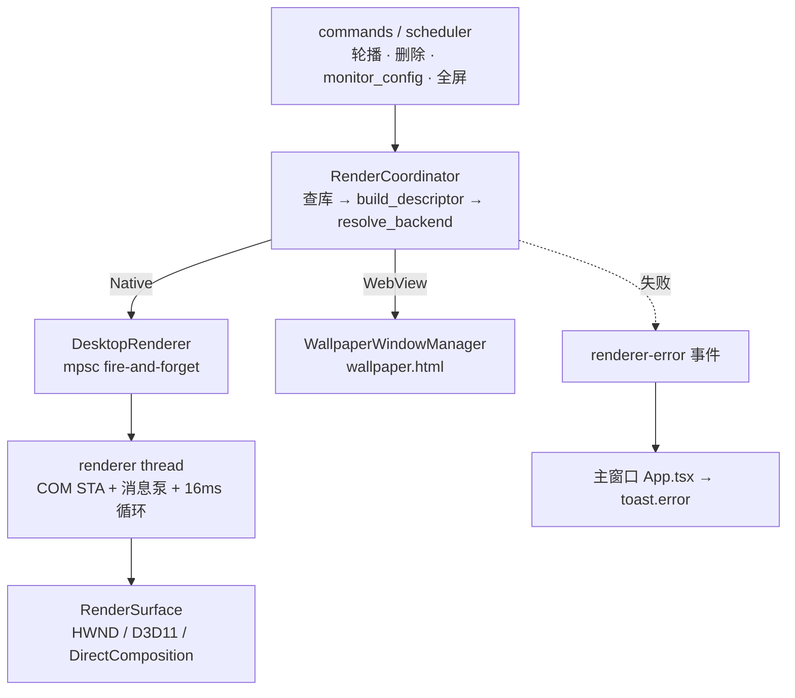

# Native Wallpaper Renderer 技术文档

> **模块路径**: `src-tauri/src/platform/wallpaper_renderer/`（跨平台契约）+ `src-tauri/src/platform/windows/desktop_renderer/`（Windows 实现）+ `src-tauri/src/ctx/render_coordinator.rs`（协调器）
> **最后更新**: 2026-11-19
> **适用系统**: Windows 11 24H2 / 25H2 实机验证通过；macOS / Linux 编译通过但为空实现
> **关联文档**: `DESKTOP_EMBEDDER_TECH_DOC.md`（WorkerW 嵌入层，本文档不重复其版本兼容与 NC 补偿细节）
> **分支**: `feature/native-wallpaper-renderer`

---

## 一、模块概述

`desktop_renderer` 是 mini-wallpaper 的**原生壁纸渲染层**，用一条 D3D11 + DirectComposition 渲染线程替代「每个显示器一个 WebView2 壁纸窗口」的方案，把图片 / GIF / 动态 WebP 直接画进 WorkerW 桌面层级。

### 1.1 为什么要做

原方案为每块显示器创建一个 `.decorations(false).transparent(true)` 的 Tauri 窗口加载 `wallpaper.html`。内存大头不在 WorkerW 嵌入本身，而在**每屏一份 Edge/Chromium renderer 进程**：壁纸只是展示一张图片，却要为它常驻一套完整浏览器渲染管线。

```
改造前：每屏 1 个 WebView2 窗口 = 每屏 1 套 Chromium renderer
改造后：全应用 1 个 D3D11 device + 1 条渲染线程 + 每屏 1 个 IDCompositionVisual
```

WorkerW / Progman / SHELLDLL_DefView 的桌面嵌入层**继续复用** `desktop_embedder`，原生渲染只替换「窗口里画什么」这一层。

### 1.2 桌面层级中的落点

```
┌──────────────────────────────────────────────────────────┐
│  Progman (24H2+)                                          │
│    ├── WorkerW (子窗口 #0) ← SHELLDLL_DefView（桌面图标）   │
│    └── WorkerW (子窗口 #1) ← 壁纸嵌入目标                  │
│          └── NativeWindow (WS_CHILD, WS_EX_NOREDIRECTIONBITMAP)
│                └── IDCompositionTarget
│                      └── IDCompositionVisual
│                            └── IDXGISwapChain1 (ForComposition)
│                                  └── D3D11 RenderTargetView
│                                        └── 纹理 QUAD
└──────────────────────────────────────────────────────────┘
```

> `SHELLDLL_DefView` 在 Progman 子窗口 #0、目标 WorkerW 在 #1 属于 24H2 的正常壁纸层级，不是嵌入错位。

### 1.3 产品边界（已确认的设计决策）

| 决策 | 结论 | 理由 |
|------|------|------|
| 系统壁纸 API | ❌ 不采用 | 无法承载 GIF / 视频 / 轮播 / 逐屏配置 |
| `.webp` / `.webm` | 媒体格式，**不是 HTML 网页壁纸** | 扩展名相同不代表渲染模型相同 |
| HTML / JS / WebGL 网页壁纸 | 暂不支持 | 需要浏览器运行时，与降内存目标冲突 |
| 图片 / 视频 | 一律走 WorkerW + 原生渲染器 | 保持逐屏一致的输入路径 |
| FFmpeg | ❌ 不引入 | 体积 / 许可 / 构建链成本过高 |
| 不支持的格式 | 直接报错，不静默降级 | 避免「以为显示成功其实没画面」 |
| WebView / Native 并存 | ✅ 接受 | 本地验证期间必须 **NativeOnly、零 WebView** |
| WebView fallback 语义 | **解码前 capability fallback** | 选中 Native 后解码失败只报错，不能当 error fallback |
| fallback 页面 | 复用现有 `wallpaper.html` + `src/pages/wallpaper/` | 不新建极简 fallback 页，避免第二套前端 |
| fallback 窗口生命周期 | 非持续存在 | 切回 Native 可支持格式时销毁 |
| 渲染 API | D3D11 | 与 DirectComposition / DXGI flip model 配套最成熟 |

---

## 二、架构分层：控制面 / 渲染面分离

### 2.1 职责边界

| 层 | 位置 | 负责 | 不负责 |
|----|------|------|--------|
| **控制面** | `runtime/scheduler`、`services`、`commands`、`RenderCoordinator` | 决定「显示什么」：查库、选壁纸、轮播、fitMode、全屏暂停、backend 决策 | 不碰 HWND / D3D11 / COM |
| **渲染面** | `platform/wallpaper_renderer`、`platform/windows/desktop_renderer` | 决定「怎么画」：解码、纹理上传、swapchain、Present、窗口几何 | **不查 DB、不认识实体、不做业务判断** |



**为什么协调器不塞进 `WallpaperWindowManager`**：WM 只管 WebView 窗口创建与事件 emit，不持有 db / renderer，无法判断壁纸能否被原生解码；把 backend 决策塞进去会让它同时依赖 db 与 renderer，且通知方法是同步 emit，承载不了「查库 → 决策 → 路由」的异步链。独立协调器让调用方只锁一个对象，避免双锁持锁。

### 2.2 渲染契约（`contracts.rs`）

```rust
#[derive(Clone, Debug, PartialEq, Eq, Serialize, Deserialize)]
#[serde(rename_all = "camelCase")]
pub struct RenderDescriptor {
    pub monitor_id: String,
    pub wallpaper_id: Option<i32>,
    pub file_path: PathBuf,
    pub kind: WallpaperKind,
    pub fit_mode: FitMode,
    pub display_mode: DisplayMode,
    pub backend: RenderBackend,
    pub extend_viewport: Option<ExtendViewport>,
}
```

契约表达的原则是：**渲染层接收一份完整描述，不再反问业务层**。当前 `RenderCoordinator` 内部实际使用的是精简版 `Descriptor { file_path, kind, backend, fit_mode }`，`RenderDescriptor` / `ExtendViewport` / `DisplayMode` 属于 M5 mirror / extend 的**契约先行**部分（详见 5.3）。

错误码统一为 `RendererErrorCode`（`UnsupportedFormat` / `BackendUnavailable` / `DecodeFailed` / `DeviceLost` / `EmbedFailed` / `BackendSwitchFailed`），经 `RendererErrorPayload` 发到前端。

### 2.3 backend 决策（`selection.rs`）

| 模式 | 生效条件 | 行为 |
|------|----------|------|
| `NativeOnly` | `cfg!(debug_assertions)` 恒真；或 release 下 `MINI_WALLPAPER_RENDERER=native` | 绝不创建 WebView；不支持格式直接报错 |
| `Auto` | release 默认 | 允许原生不支持的视频格式回退 WebView |

```rust
pub fn resolve_backend(
    kind: WallpaperKind,
    file_path: &Path,
    selection: BackendSelection,
) -> Result<RenderBackend, RendererError>
```

| 壁纸 | NativeOnly | Auto |
|------|-----------|------|
| 图片 / GIF / WebP（静态与动态） | `Native` | `Native` |
| `.mp4` / `.m4v` | `Native` | `Native` |
| `.webm` / `.mkv` / `.avi` / `.mov` | `UnsupportedFormat` 报错 | `WebView` |
| 其它视频扩展名 | `UnsupportedFormat` 报错 | `UnsupportedFormat` 报错 |

> **Auto 模式下 WebView 是解码前的 capability fallback，不是解码失败后的兜底。** 一旦 `resolve_backend` 返回 Native，后续 `decode_frames` 失败只会走 `log::error!` + `renderer-error`，不会偷偷重建一个 WebView 窗口。

### 2.4 错误上报链路

```
RenderCoordinator::report_error
  → TypedEmit(RendererErrorPayload { monitor_id, wallpaper_id, code, message })
  → EVENTS.RENDERER_ERROR ("renderer-error")
  → App.tsx useEffect listen → toast.error(`${message} (${monitor_id})`)
```

前端 `EventMap` 同步补齐了 `RendererErrorPayload`，保持既有事件类型安全。

---

## 三、最终方案：D3D11 + DirectComposition

### 3.1 窗口创建：创建期样式是关键

```rust
// window.rs
CreateWindowExW(
    WS_EX_NOREDIRECTIONBITMAP | WS_EX_NOACTIVATE | WS_EX_TOOLWINDOW,
    CLASS_NAME, WINDOW_NAME, WS_POPUP,
    rect.x, rect.y, rect.width, rect.height, ...
)?;
```

`WS_EX_NOREDIRECTIONBITMAP` 是**创建期样式**，不能等 `SetParent` 之后再补。它告诉 DWM 不要为这个 HWND 建立传统 GDI 重定向位图——DirectComposition target 依赖这一点。窗口类 `MiniWallpaperNativeRenderer` 用 `OnceLock` 保证只注册一次，`Drop` 里 `DestroyWindow`。

### 3.2 嵌入与 swapchain 的时序

`RenderSurface::new` 的顺序不可调换：

```
1. NativeWindow::new          （创建窗口，带 WS_EX_NOREDIRECTIONBITMAP）
2. embed_in_desktop(..., EmbedPolicy::Native)   ← 先拿到最终父子关系
3. window.show() + normalize_native_ex_style()
4. D3D11CreateDevice          （BGRA_SUPPORT）
5. create_pipeline            （shader / input layout / VB / sampler / rasterizer）
6. create_composition_swap_chain(device, hwnd, w, h)
7. bind_current_backbuffer()
```

早期版本在 `SetParent` 之前就创建 HWND swapchain，DXGI 拿到的 HWND 还是顶层窗口，改成子窗口后合成目标失效。**必须先嵌入、再建 device / swapchain。**

### 3.3 共享嵌入策略的 `EmbedPolicy`

`desktop_embedder` 被 WebView 与 Native 共用，但两者窗口前提不同，因此 `embed_in_desktop` 增加一个 `policy` 参数并透传到 `EmbedStrategy::embed`：

```rust
#[derive(Clone, Copy, Debug, PartialEq, Eq)]
pub enum EmbedPolicy { WebView, Native }
```

| 行为 | `EmbedPolicy::WebView` | `EmbedPolicy::Native` |
|------|------------------------|----------------------|
| 清除 `WS_POPUP` | ❌ 不清除（保持 main 原有混合样式） | ✅ 必须清除 |
| `GetParent(hwnd) == workerw` 校验 | ❌ 不校验 | ✅ 校验，不匹配 `bail!` |
| 调用方 | `window_manager.rs::create_and_show` | `surface.rs::RenderSurface::new` |

原因：`WS_POPUP` 与 `WS_CHILD` 互斥，原生窗口若不清掉，`SetParent` 只会设 owner，`GetParent` 返回 `0x0`。但 WebView 窗口（tao 创建的无边框透明 `WS_POPUP` 窗口）的原有嵌入语义已经在 main 上验证可用，不能因为原生渲染器就让它静默换一种窗口模型。详见 6.3。

`normalize_native_ex_style()` 在 embed **之后**执行：共享嵌入策略会给所有窗口加 `WS_EX_TRANSPARENT`（WebView 鼠标穿透需要），原生 DirectComposition 窗口不需要；`WS_EX_NOACTIVATE` / `WS_EX_TOOLWINDOW` 属于顶层窗口语义，成为 WorkerW 子窗口后一并清掉；唯一必须保留的是 `WS_EX_NOREDIRECTIONBITMAP`。

### 3.4 DirectComposition 链路

HWND bitblt swapchain 依赖传统 GDI redirection surface，在 24H2 的桌面合成树里不会被采样（Present 返回成功但桌面无画面）。改为 composition swapchain：

```rust
let desc = DXGI_SWAP_CHAIN_DESC1 {
    Format: DXGI_FORMAT_B8G8R8A8_UNORM,
    BufferCount: 2,
    Scaling: DXGI_SCALING_STRETCH,
    SwapEffect: DXGI_SWAP_EFFECT_FLIP_SEQUENTIAL,
    AlphaMode: DXGI_ALPHA_MODE_PREMULTIPLIED,
    BufferUsage: DXGI_USAGE_RENDER_TARGET_OUTPUT,
    ..
};
let swap_chain: IDXGISwapChain1 =
    factory.CreateSwapChainForComposition(&device_unknown, &desc, None::<&IDXGIOutput>)?;

let composition_device: IDCompositionDevice = DCompositionCreateDevice(&dxgi_device)?;
let composition_target = composition_device.CreateTargetForHwnd(hwnd, true)?;
let composition_visual = composition_device.CreateVisual()?;
composition_visual.SetContent(&swap_chain.cast::<IUnknown>()?)?;
composition_target.SetRoot(&composition_visual)?;
composition_device.Commit()?;
```

`CreateSwapChainForComposition` 的硬约束：`FLIP_SEQUENTIAL` + `STRETCH` + premultiplied alpha + `BufferCount = 2`。`IDCompositionDevice` / `Target` / `Visual` 必须作为 `RenderSurface` 字段持有到析构，否则 COM 引用释放后合成树立刻断掉。

### 3.5 COM apartment 与渲染线程

DirectComposition 是 COM API，renderer thread 必须自己初始化 STA：

```rust
struct ComScope { should_uninitialize: bool }
// CoInitializeEx(None, COINIT_APARTMENTTHREADED)
// RPC_E_CHANGED_MODE → 已被其它并发模型初始化，跳过 CoUninitialize
// Drop → CoUninitialize()
```

线程循环：`try_recv` 排空命令 → `pump_messages()`（`PeekMessageW` / `WM_QUIT` 退出）→ 未暂停时逐 surface `render()` → `sleep(16ms)`。全屏暂停时只跳过绘制，**保留 surface 与已解码纹理**，恢复后无需重新解码。

### 3.6 解码与纹理上传（`decoder.rs` / `surface.rs`）

| 格式 | 解码路径 |
|------|----------|
| GIF | `GifDecoder` + `AnimationDecoder::into_frames()` |
| WebP（含动态） | `WebPDecoder` + `AnimationDecoder::into_frames()` |
| 其它静态图 | `image::open` |
| 帧数据 | `rgba_to_bgra` → `DXGI_FORMAT_B8G8R8A8_UNORM` 纹理 → `CreateShaderResourceView` |
| 延迟 | `Frame::delay()` → `Duration`；0 延迟按 100ms（主流播放器惯例，否则卡首帧） |

动画帧按**总时长取模**循环选取，而不是播完一轮停在首帧：

```rust
let elapsed = now.saturating_duration_since(started_at).as_nanos() % total.as_nanos();
```

`GpuFrame` 只保存 SRV，texture 由 SRV 内部持有引用，不再重复保存一份。

### 3.7 QUAD / shader 与 `CULL_NONE`（最终修复点 ⭐）

顶点为 `TRIANGLESTRIP` 的全屏四边形，顺序 `左下 → 右下 → 左上 → 右上`：

```hlsl
float4 ps_main(VS_OUT input) : SV_TARGET {
    float4 color = wallpaper.Sample(linear_sampler, input.uv);
    color.a = 1.0;   // premultiplied alpha 桌面合成下强制不透明
    return color;
}
```

**这个绕序与 D3D 默认正面绕序相反**，默认 `CullMode = BACK` 会把两个三角形全部丢掉，导致 `Draw(4, 0)` 零输出——而 `Present` 依然成功、清屏色依然可见。生产修复是显式关背面剔除，不依赖 `RSSetState(NULL)` 的隐式默认值：

```rust
let rasterizer_desc = D3D11_RASTERIZER_DESC {
    CullMode: D3D11_CULL_NONE,
    FillMode: D3D11_FILL_SOLID,
    FrontCounterClockwise: FALSE,
    DepthClipEnable: BOOL(1),
    ..
};
// 每帧 Draw 前
self.context.RSSetState(&pipeline.rasterizer_state);
self.context.Draw(4, 0);
```

### 3.8 fit mode 与显示器几何

`fit_rect()` 把源图映射到目标矩形，结果直接作为 `D3D11_VIEWPORT`（cover / center 允许超出目标区域，由视口裁剪）：

| 模式 | 行为 |
|------|------|
| `cover` | 等比缩放取 `max(scale)`，居中后溢出部分裁掉 |
| `contain` | 等比缩放取 `min(scale)`，居中留边（清屏色填充） |
| `fill` / `stretch` | 拉伸铺满（CSS `object-fit: stretch` 会回退到 fill） |
| `center` | 原尺寸居中 |

显示器几何变化走 `update_rect()`，**不重建整张 surface**：先 `OMSetRenderTargets(None)` 释放全部 backbuffer 引用（`ResizeBuffers` 否则返回 `DXGI_ERROR_INVALID_CALL`）→ `SetWindowPos` → `ResizeBuffers(2, w, h, ...)` → 重新绑定 RTV。rect 未变化则直接 `Ok(())`，保证幂等。

### 3.9 Flip model 的 backbuffer

`FLIP_SEQUENTIAL` 下每次 `Present` 后 backbuffer 会轮转，**每帧都必须重新 `GetBuffer(0)` 并重建 / 绑定 RTV**，不能复用上一帧的 RTV：

```rust
fn bind_current_backbuffer(&mut self) -> Result<()> {
    self.context.OMSetRenderTargets(Some(&[None]), None::<&ID3D11DepthStencilView>);
    self.render_target = None;
    let back_buffer: ID3D11Texture2D = self.swap_chain.GetBuffer(0)?;
    let rtv = self.device.CreateRenderTargetView(&back_buffer, None, ...)?;
    self.context.OMSetRenderTargets(Some(&[Some(rtv.clone())]), None);
    self.render_target = Some(rtv);
    Ok(())
}
```

`Present` 的 HRESULT 需注意：`0x00000000` 是 `S_OK`，`DXGI_STATUS_OCCLUDED` / `DXGI_STATUS_CLIPPED` 属于成功状态，被 `.ok()` 吞掉属正常，不能据此判断画面可见。

---

## 四、踩坑历程：方案演进全记录

### 阶段 0：M0 ~ M4 主干实现（`d15f251` → `d9bb998`）

| 里程碑 | 内容 |
|--------|------|
| M0 | 渲染契约 `contracts.rs`、backend 选择、`renderer-error` 事件链路 |
| M1 | `DesktopRenderer` 独立渲染线程 + mpsc 命令 + 消息泵 |
| M2 | 图片 / GIF / WebP 解码、D3D11 纹理上传、full-screen quad / shader / SRV / sampler |
| M3 | fit mode、显示器几何幂等更新、`ResizeBuffers` 引用释放 |
| M4 | `RenderCoordinator` 落地，改造 carousel / deletion_effects / monitor_config / wallpaper_window / fullscreen_detector |

### 阶段 1：Windows dev 日志里没有渲染循环日志（`2244e91` → `f1ee384`）

先补 pipeline / loop / window state 三层诊断日志，确认本地跑的不是最新 commit、需要强制重编译。用户更新后确认首帧绘制与 `Present` 成功——但桌面依然没有画面。**这排除了「渲染循环没跑」，把问题域收敛到「画了但没被看到」。**

### 阶段 2：`parent=0x0 style=0xD4000000`（`bc71725`）

`ModernStrategy` 漏清 `WS_POPUP`。`WS_POPUP` 与 `WS_CHILD` 互斥，`SetParent` 后 `GetParent` 仍为 0，窗口根本没挂进 WorkerW。修复：嵌入前清掉 `WS_POPUP` 并加父子关系校验。

> ⚠️ 这一步当时改在**共享的** `ModernStrategy` 上，后来在 M4 收束时发现会影响 WebView（见阶段 9 / 6.3）。

### 阶段 3：swapchain 创建太早（`ff799e3`）

HWND swapchain 在 `SetParent` 之前创建，DXGI 绑定的是尚未成为子窗口的 HWND。改为「先 embed + show，再创建 device / pipeline / swapchain」。用户 pull 后仍无画面。

### 阶段 4：WorkerW 层序与 DWM 遮挡（`41e8fad` → `66d0b72`）

dump WorkerW 子窗口 Z-order、Progman 层级、DWM occlusion 状态。确认：

- `SHELLDLL_DefView` 在 Progman 子窗口 #0、目标 WorkerW 在 #1 是 24H2 正常层级；
- Progman `exstyle=0x200080` 含 `WS_EX_NOREDIRECTIONBITMAP`（`0x00200000`）。

> `6143350` 修正过一次文档误读：`0x00200000` 是 `WS_EX_NOREDIRECTIONBITMAP`，**不是** `WS_EX_COMPOSITED`（`0x02000000`），两者差一位十六进制数，结论完全不同。

### 阶段 5：扩展样式归一化（`051e2a6`）

创建期补 `WS_EX_NOREDIRECTIONBITMAP`，embed 后清掉 `WS_EX_TRANSPARENT` / `WS_EX_NOACTIVATE` / `WS_EX_TOOLWINDOW`。这一步当时是失败 A/B 的残留，后来重新定性为 Native 专用（见 8.2）。

### 阶段 6：切 DirectComposition（`33c9e7b`）⭐ 关键转折

HWND bitblt swapchain 在传统 GDI 重定向表面工作，但 24H2 桌面根链走 DWM / DirectComposition 合成树，不采样它。改为 `CreateSwapChainForComposition` + `CreateTargetForHwnd` + `CreateVisual` + `SetContent` + `SetRoot` + `Commit`，同时补 COM STA 与每帧重绑 backbuffer。用户反馈「有一点进展了」：**桌面出现纯深蓝灰，但没有图片。**

### 阶段 7：清屏色 ≠ 窗口可见（前提被推翻）

当时把「深蓝灰」当作 `ClearRenderTargetView` 生效的证据，进而怀疑纹理 / shader。用户反馈「**颜色不变**」后，这个前提被推翻：深蓝灰也可能只是父窗口背景或未初始化的表面，不能证明刷新链路在跑。于是加**无条件清屏色心跳**（每约 1.5s 轮换三种颜色），把「窗口可见 + 每帧刷新」变成可观测事实。

### 阶段 8：心跳 A/B → `CULL_NONE`（`4c97fde` → `8694e67` → `da22a50`）⭐ 最终修复

诊断手段与判读：

| 探针 | 回答的问题 | 结果 |
|------|-----------|------|
| shader A/B（`ps_main` / `ps_debug_solid` / `ps_debug_uv`） | 纹理采样链路是否通 | 都无输出 |
| CPU 回读 backbuffer（staging texture + `CopyResource` + `Map`） | GPU 是否真的写入了 | 只有清屏色 |
| 无条件清屏色心跳 | 窗口是否可见、是否被合成、是否每帧刷新 | **三种颜色轮换闪烁 ✅** |

心跳证明窗口可见且 Present 链路正常 ⇒ 问题只可能在 `Draw(4, 0)` 本身 ⇒ 锁定 QUAD 绕序与背面剔除。显式 `D3D11_CULL_NONE` 后用户确认「**壁纸正常显示，切换也能正常渲染新壁纸**」。

### 阶段 9：诊断脚手架清理与 WebView 隔离（`b2a01a0` → M4 收束）

删除 debug shader、backbuffer readback、心跳、窗口状态 dump、桌面层级枚举、冗余日志；保留 `CULL_NONE` 与正常渲染链路。随后发现共享 `ModernStrategy` 的 `WS_POPUP` 改动会影响 WebView，引入 `EmbedPolicy` 收窄。

### 诊断方法沉淀

1. **先证伪前提**：「看到清屏色」不等于「渲染链路在跑」，用无条件心跳把可见性做成可观测事实。
2. **分层 A/B**：把「窗口可见 / Present / GPU 写入 / Draw 输出」拆成独立可证伪命题，逐层排除。
3. **HRESULT 不等于画面**：`Present` 返回 `S_OK` 或 `DXGI_STATUS_OCCLUDED` 都不能推断桌面可见。
4. 排查期日志与探针一次性引入、定位后一次性清除，不留在生产代码里。

---

## 五、关键结论

### 5.1 三个必须分开处理的独立问题

| 问题 | 根因 | 解决方案 | 状态 |
|------|------|----------|------|
| 窗口未挂进 WorkerW | `WS_POPUP` 与 `WS_CHILD` 互斥，`GetParent=0x0` | Native 路径清 `WS_POPUP` + 父子校验 | ✅ 已解决 |
| Present 成功但桌面无画面 | HWND bitblt swapchain 不被 24H2 合成树采样 | DirectComposition composition swapchain | ✅ 已解决 |
| 清屏色可见但图片不可见 | QUAD 绕序触发默认背面剔除，`Draw` 零输出 | `D3D11_CULL_NONE` + `RSSetState` | ✅ 已解决 |

混淆这三者（尤其是把第 3 个当成第 2 个的纹理问题）是这次排查走弯路的主要原因。

### 5.2 关键不变量

- `WS_EX_NOREDIRECTIONBITMAP` **必须在 `CreateWindowExW` 时带上**，事后补无效。
- **先 embed 再建 swapchain**，DirectComposition target 绑定的是最终 HWND。
- composition COM 对象（device / target / visual）必须活到 `RenderSurface` 析构。
- flip model 下**每帧重绑 backbuffer**；`ResizeBuffers` 前必须先释放所有 RTV 引用。
- renderer thread 需要自己的 STA `CoInitializeEx` / `CoUninitialize` 配对。
- WebView 与 Native 共用 `desktop_embedder`，但**样式前提不同**，任何策略改动必须带 `EmbedPolicy` 判别。
- `DesktopRenderer` 的命令是 mpsc fire-and-forget，**同 channel FIFO 保证顺序**，但没有 ack：「`ensure_target` 返回 Ok」≠「renderer thread 已完成 surface 创建 / 纹理上传」。

### 5.3 已知限制（如实记录，非疏漏）

| 项 | 现状 | 影响 / 计划 |
|----|------|-------------|
| **Native 视频解码未实现** | `resolve_backend` 把 `.mp4` / `.m4v` 判为 `Native`，但 `decode_frames` 只有 `image` crate 路径，`Surface::set_wallpaper` 的 `kind` 参数当前为 `_kind` 未消费 | 这两类视频走 Native 会在解码阶段失败 → `log::error!` + `renderer-error` toast，不会回退 WebView。属契约先行，需 M5+ 接 MediaFoundation；在那之前如需可用，应把这两类扩展名临时判为 `WebView` |
| **`RenderDescriptor` 未被生产消费** | `RenderCoordinator` 用内部精简 `Descriptor`；`RenderDescriptor` / `ExtendViewport` / `DisplayMode` 及 `DeviceLost` / `EmbedFailed` / `BackendSwitchFailed` 错误码仅定义并导出 | M0 契约为 mirror / extend 预留，M5 才会真正使用。模块顶部 `#![allow(dead_code, unused_imports)]` 即为此 |
| **mirror / extend 未做跨屏视口** | 当前按 Q2 决策「暂时都用 wid 各自渲染」，`resolve_targets` 只做同步 / 独立的目标集合选择 | M5 实现真实跨屏视口与共享纹理 |
| **运行时动态 backend 切换** | `apply_backend` 已支持跨 backend 切换（先销毁旧目标再建新目标），但 `selection` 在 `RenderCoordinator::new` 时固定 | 运行时切换推到 M8 |
| **命令无 ack** | `ensure_monitor` / `set_wallpaper` 发送后立即返回，失败只落在 renderer thread 日志，不回传 `renderer-error` | 需要时改为 oneshot 回执 |
| **无视频 / 无 HTML 网页壁纸** | 产品边界决策 | 见 1.3 |
| **DWM 圆角 ~1px** | 继承自 `desktop_embedder`，选择接受 | 见关联文档 |
| **旧版本 Windows 未实测** | DirectComposition 链路只在 24H2 / 25H2 实机验证 | legacy 嵌入路径沿用社区成熟方案，未实测 |

---

## 六、代码架构

### 6.1 文件结构

```
src-tauri/src/
├── platform/
│   ├── wallpaper_renderer/                 跨平台契约（不依赖 windows crate）
│   │   ├── mod.rs                          facade：Windows 导出真实 DesktopRenderer，
│   │   │                                   其它平台同签名 no-op（macOS/CI 可编译）
│   │   ├── contracts.rs                    RenderDescriptor / enums / RendererError
│   │   ├── selection.rs                    default_backend_selection / resolve_backend
│   │   ├── decoder.rs                      image 0.25：GIF / WebP / 静态图 → BGRA 帧
│   │   └── fit.rs                          fit_rect → D3D11_VIEWPORT，含单元测试
│   │
│   └── windows/
│       ├── desktop_embedder/               复用既有 WorkerW 嵌入层
│       │   ├── mod.rs                      EmbedPolicy + embed_in_desktop(policy)
│       │   ├── strategy.rs                 EmbedStrategy::embed(..., policy)
│       │   ├── modern.rs                   24H2+：policy==Native 才清 WS_POPUP / 校验 parent
│       │   └── legacy.rs                  旧版本：忽略 policy
│       │
│       ├── desktop_renderer/
│       │   ├── mod.rs                      导出 DesktopRenderer
│       │   ├── renderer.rs                 渲染线程：mpsc 命令 / ComScope / 消息泵 / 16ms 循环
│       │   ├── window.rs                   NativeWindow：窗口创建 / exstyle 归一 / bounds / Drop
│       │   └── surface.rs                  D3D11 device / DirectComposition / pipeline /
│       │                                  纹理上传 / render / update_rect / destroy
│       └── DESKTOP_EMBEDDER_TECH_DOC.md
│
├── ctx/
│   ├── render_coordinator.rs               渲染链路唯一入口（backend map / rect map / 路由 / 错误上报）
│   ├── window_manager.rs                   WebView 窗口，embed 传 EmbedPolicy::WebView
│   └── mod.rs                              AppContext 持有 Arc<Mutex<RenderCoordinator>>
├── commands/wallpaper_window.rs            create / destroy / hide / show / active_ids 全改走协调器
├── commands/monitor_config.rs              fitMode / 壁纸变更走协调器
├── runtime/scheduler/deletion_effects.rs   WmNotification → RenderNotification 批量派发
├── runtime/tasks/carousel.rs               换图走 coordinator.update_wallpaper
├── runtime/tasks/fullscreen_detector.rs    暂停走 coordinator.set_paused
├── events.rs                               RendererErrorPayload
└── Cargo.toml                              [target.'cfg(windows)'] 追加 windows 0.61
                                            （D3D11 / Dxgi / DirectComposition / COM / Fxc / Gdi）
```

前端：`src/api/event.ts` 增 `RENDERER_ERROR` + `RendererErrorPayload` + `EventMap`；`src/pages/main/App.tsx` 单点监听并 toast。

### 6.2 RenderCoordinator 的 backend 状态

```
backends: HashMap<monitor_id, RenderBackend>   ← 当前 active backend
rects:    HashMap<monitor_id, MonitorRect>     ← 跨 backend 切换时重建目标用
selection: BackendSelection                    ← 进程启动时确定
```

| 入口 | 行为 |
|------|------|
| `ensure_target` | 查库 → `build_descriptor` → Native 建 surface + 首帧 / WebView 建窗口 |
| `update_wallpaper` | 每张目标屏重新决策 backend，`apply_backend` 需要时销毁旧目标再建新目标，随后发 `thumbnail-changed` |
| `destroy_target` | 按当前 backend 选择 renderer / WM 清理路径 |
| `clear_wallpaper` / `set_fit_mode` | 按 backend 分流 |
| `set_paused` | Native 停帧 + WebView `hide_all` / `show_all` |
| `dispatch_notifications` | `RenderNotification::Updated/Cleared` 批量派发，DB 阶段收集、短锁内一次性执行 |
| `active_ids` | Native + WebView 合并去重 |

`RenderNotification` 替代了 `WmNotification`，目的是把「查库 → 决策 → 路由」从 `WindowManager` 锁内搬出去，延续 P1 的锁范围治理。

### 6.3 EmbedPolicy：modern 改动要不要保留？对 WebView 有无影响？

**结论：必须保留，但必须按 backend 收窄。** 取证：

1. `window_manager.rs` 和 `surface.rs` 都调用 `embed_in_desktop`，24H2 下都走 `ModernStrategy`；
2. WebView 窗口由 tao 以 `.decorations(false).transparent(true)` 创建，Windows 上就是 `WS_POPUP`；
3. 若 `ModernStrategy` 无条件清 `WS_POPUP` 并强制 `GetParent == workerw`，等于让一条**已在 main 上验证可用**的 WebView 路径静默换成另一种窗口模型，且校验失败会直接 `bail!`。

因此 `EmbedPolicy::WebView` 保持 main 的原始行为（不清 `WS_POPUP`、不做父子校验），`EmbedPolicy::Native` 才执行两项新逻辑。`LegacyStrategy` 接收但忽略 policy。这样原生渲染器的必需修复不会外溢到 WebView fallback 路径。

### 6.4 日志策略

排查期加的 info / debug / success 日志**全部移除**，只保留可诊断生产故障的日志：

| 保留 | 删除 |
|------|------|
| `CoInitializeEx` 失败 / `RPC_E_CHANGED_MODE` / `WM_QUIT` | `[Renderer] 渲染线程已启动/退出` |
| surface 创建 / 更新失败、解码失败、surface 不存在 | `表面已创建并嵌入桌面`、`壁纸纹理已上传`、`渲染暂停状态更新` |
| backbuffer 绑定失败、`Present` 失败（各自只记一次，避免每帧刷屏） | `[RenderCoordinator] 首帧 backend=...`、`渲染目标已就绪`、`换图 wid=...` |
| 协调器销毁 / 更新 / fitMode / 事件发送失败 | 首帧 info、DirectComposition 创建 info、父窗口验证 info、窗口状态 dump |
| `renderer-error` 事件发送失败 | 全部诊断 shader / 心跳 / backbuffer readback 相关日志 |

节流字段 `present_error_logged` / `backbuffer_error_logged` 保留，重置条件写在成功分支里。

### 6.5 跨平台 facade

`wallpaper_renderer/mod.rs` 在 Windows 下 `pub use` 真实 `DesktopRenderer`，其它平台提供同签名 no-op，让 `RenderCoordinator` 无需 `cfg` 分支即可统一调用——macOS 开发机与 CI 上 `cargo check` 不受 Windows target 依赖影响。

---

## 七、Git 提交时间线

> 以下为**演进过程**记录。M4 收束时按用户要求把整段历史压缩为**一个** commit 并 force push，因此最终分支上这些中间 commit 不再存在。

```
── M0 ~ M4 主干 ──────────────────────────────────────────────
d15f251  feat: add native wallpaper renderer contracts
a6161aa  feat: add native wallpaper renderer thread
e6660a8  feat: add native wallpaper texture rendering
e538f36  feat: support fit modes and monitor geometry updates
d9bb998  feat: route wallpaper updates through native renderer coordinator

── Windows 实机排查：诊断层 ───────────────────────────────────
2244e91  log: add native renderer pipeline diagnostics
3783d2a  log: add native renderer loop diagnostics
f1ee384  log: add native renderer window state diagnostics
41e8fad  log: dump WorkerW child window z-order
66d0b72  log: add DWM occlusion and desktop hierarchy diagnostics
30d8c09  log: add DirectComposition draw loop diagnostics
4c97fde  log: add backbuffer readback and shader A/B diagnostics
8694e67  log: add unconditional clear-color heartbeat for window visibility A/B ⭐

── Windows 实机排查：修复层 ───────────────────────────────────
bc71725  fix: clear popup style for native desktop embedding
ff799e3  fix: create swapchain after desktop embedding
051e2a6  fix: normalize native child window styles for DWM composition
6143350  docs: correct DWM exstyle rationale
33c9e7b  fix: render native wallpaper through DirectComposition ⭐
da22a50  fix: disable back-face culling on native wallpaper quad ⭐ 最终修复
b2a01a0  refactor: remove native renderer troubleshooting diagnostics
         ↓ M4 收束：EmbedPolicy 隔离 WebView / 悬垂方法重新定性 / 冗余日志清理
         ↓ 压缩为单个 commit + force push（当前版本 ⭐）
```

merge-base：`1929233d5001327583b617ff7f9119f61e55527c`。

---

## 八、代码质量改进记录

### 8.1 诊断脚手架一次性清除（`b2a01a0`）

删除 debug shader（`ps_debug_solid` / `ps_debug_uv`）、清屏色心跳、backbuffer CPU 回读、`dump_window_state` / `dump_progman_children` / `dump_child_windows` / `window_class_name`、`first_render_logged` 字段及专有 imports。清屏色恢复固定 `[0.08, 0.12, 0.18, 1.0]`，`PSSetShader` 恢复 `ps_main`。**唯一保留的排查产物是真正的修复：`CULL_NONE` rasterizer state。**

### 8.2 悬垂失败：`normalize_child_ex_style`

该方法原本来自失败 A/B，命名与注释都指向「24H2 子窗口通用归一化」，但：

- 它只在 `surface.rs` 的 Native 路径被调用，WebView 完全不走；
- 注释里的「Progman 带 `WS_EX_NOREDIRECTIONBITMAP`」是推断，不是该方法生效的直接原因。

处理方式**不删除行为**（实机已验证可用，删掉有回归风险），而是重新定性：

- 改名 `normalize_native_ex_style`；
- 注释改为解释 WHY：共享嵌入策略会加 `WS_EX_TRANSPARENT`，原生 DirectComposition 窗口不需要；`WS_EX_NOACTIVATE` / `WS_EX_TOOLWINDOW` 是顶层窗口语义；必须在 embed 之后执行，因为嵌入策略会重设 exstyle；唯一要留的是创建期的 `WS_EX_NOREDIRECTIONBITMAP`。

### 8.3 冗余日志清理

按 6.4 的策略删除协调器 / renderer / surface 中的流程性 info，保留错误与一次性 warn。总净变化 `-91 / +67`（9 个文件）。

### 8.4 本地验证方式（不把用户当编译器）

主工程 `cargo check --target x86_64-pc-windows-msvc` 在 macOS 上被 `lzma-sys` 的 `stdlib.h` / `windows.h` 挡住，因此建立 `/tmp/wallpaper-win-probe` 最小 crate：只依赖 `windows 0.61` / `windows-sys 0.59` / `anyhow` / `log`，把真实 `surface.rs` / `window.rs` / `desktop_embedder/*` 搬入并 stub 项目内部引用，执行 `cargo check --target x86_64-pc-windows-msvc`。探针期间发现并修正：

- `ClearRenderTargetView` 需要 `&[f32; 4]` 而非 `*const f32` → 改 `&clear_color`；
- `BOOL` 在 `windows::core::BOOL`，不在 `Win32::Foundation`；
- D3D11 flag newtype 内部是 `i32`，填 `u32` 字段要 `.0 as u32`；
- `D3D11_SUBRESOURCE_DATA` 的字段是 `pSysMem`；
- `PCSTR` 接收 `*const u8`；
- stub `MonitorRect` 需 `Copy`。

验证结果：`rustfmt --edition 2021` 通过、probe 模块树 Windows target `cargo check` 通过、宿主 `src-tauri cargo check --lib` 通过（`Finished dev profile`）。

### 8.5 历史收束

21 个中间 commit（含 8 个纯诊断 log）压缩为一个 commit，去除冗余 log 与排查脚手架，force push 到 `feature/native-wallpaper-renderer`。本技术文档与最终代码状态一并入提交。

---

## 九、后续优化方向（M5+）

| 优先级 | 方向 | 说明 |
|--------|------|------|
| **P0** | Native 视频解码 | 用 MediaFoundation 把 `.mp4` / `.m4v` 接进 `DecodedFrame`；在完成前，要么实现解码、要么把这两类扩展名从 `NATIVE_VIDEO_EXTENSIONS` 移出并判为 `WebView`，消除「backend 说支持但解码必失败」的语义裂缝 |
| P1 | mirror / extend 真实跨屏视口 | 消费 `RenderDescriptor` / `ExtendViewport` / `DisplayMode`，共享纹理 + 逐屏 viewport 偏移，替代「各 wid 各自渲染」 |
| P1 | 渲染命令 ack | mpsc + oneshot 回执，把解码 / surface 失败回传 `renderer-error`，不再只落 renderer thread 日志 |
| P2 | 运行时动态 backend 切换 | `selection` 可运行时更新，配合设置项暴露（原计划 M8） |
| P2 | 设备丢失恢复 | 消费 `DeviceLost`，处理 `DXGI_ERROR_DEVICE_REMOVED` / `ResizeBuffers` 失败后的重建 |
| P2 | 显示器热插拔 / DPI 变化 | 用 Tauri 原生显示器事件替代 5s 轮询，及时 `update_rect` |
| P2 | 帧率自适应 | 静态图无需 16ms 循环，可在纹理不变时降到按需 Present |
| P3 | 契约生成 | `RenderDescriptor` 等前后端镜像类型考虑 ts-rs / specta 生成 |
| P3 | 单元测试覆盖 | 目前 `fit.rs` / `decoder.rs` / `selection.rs` / `contracts.rs` 有测试，renderer 编排与桌面嵌入仍零覆盖 |
